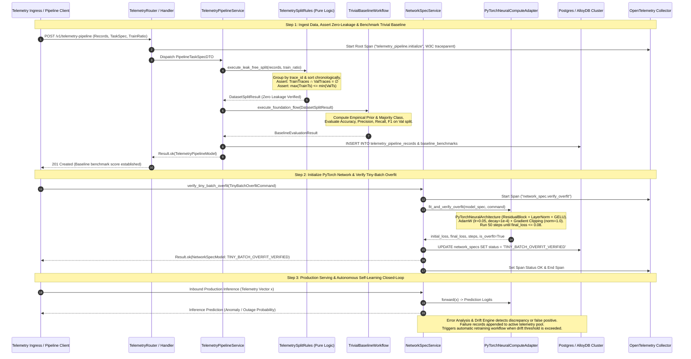
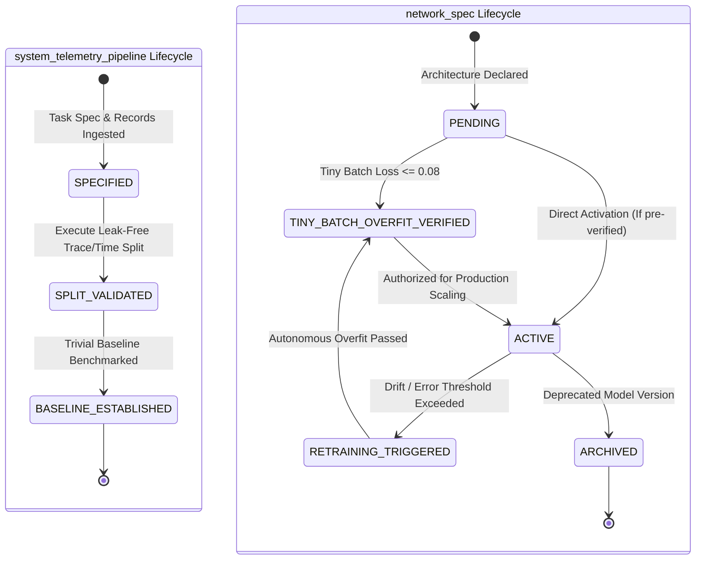
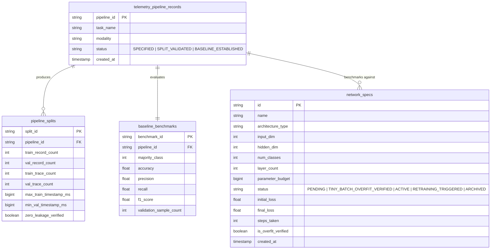

# 0001: Distributed Systems Neural Telemetry & Optimization Engine: Data Integrity, Self-Learning Closed-Loop, Leak-Free Evaluation, and PyTorch Tensor Core

- **Status**: Accepted
- **Date**: 2026-10-14
- **Authors**: Platform Architecture & Core Neural Systems Team
- **RFC / Standards**: IEEE 754 (Floating-Point Arithmetic), OpenTelemetry W3C TraceContext RFC, ISO/IEC 25010 (System and Software Quality Models)
- **Deciders**: Lead Systems Architect, Distributed Systems Lead, Machine Learning Infrastructure Engineer

---

## 1. Context & Problem Statement

Building neural networks for distributed systems telemetry (e.g. trace cascade failures, temporal worker lag, query latency spikes, and microservice anomaly detection) suffers from an engineering pathology: **practitioners jump directly into layer architecture, activation functions, and hyperparameter tuning while ignoring data integrity, objective alignment, and evaluation protocols**.

In distributed systems:
1. **Multi-Span Trace Correlation**: Single transactions span dozens of microservices. Random data splits result in the same `trace_id` appearing in both train and validation sets. The neural network achieves 99% accuracy by memorizing trace IDs, then fails completely in production.
2. **Temporal Lookahead Leakage**: Distributed events obey strict physical causality. Random splits leak future event states into past prediction horizons, destroying valid inference.
3. **Mismatched Objectives**: Optimizing raw unweighted cross-entropy on imbalanced catastrophic outages (where failures comprise < 0.1% of telemetry records) causes the network to collapse to trivial zero-prediction.
4. **Premature Tuning Without Trivial Baselines**: Engineering teams spend weeks tweaking depth and attention heads without verifying whether a trivial heuristic (majority class frequency or prior moving mean) can match or beat the architecture.
5. **Absence of Autonomous Self-Learning Feedback Loop**: Models deployed in production degrade as service topologies evolve. Without an automated continuous closed-loop that captures errors, monitors drift, validates candidate checkpoints against baseline gates, and triggers retraining, models become stale and dangerous.

---

## 2. Decision Drivers & Core Principles

1. **Mandatory Inversion of Priority**: Enforce data pipeline validation, label audit, and leak-free split generation before model code or training weights are initialized.
2. **Zero-Leakage Splitting Engine**: Guarantee trace-disjoint and temporally monotonic splits ($\text{TrainTraces} \cap \text{ValTraces} = \emptyset$ and $\max(\text{TrainTimestamp}) \le \min(\text{ValTimestamp})$).
3. **Automated Trivial Baseline Benchmark**: Establish mandatory empirical baseline performance ($F_1$, Accuracy, MAE) that every candidate neural network must surpass to justify deployment.
4. **Optimization Stability First**: Guarantee stable gradient propagation via Kaiming uniform weight initialization, Layer Normalization (`LayerNorm`), and residual skip connections.
5. **Tiny-Batch Overfitting Gate**: Mandate that models overfit 10–100 samples to near-zero loss ($\le 0.08$) to prove graph autograd validity before scaling compute.
6. **Continuous Autonomous Self-Learning Closed-Loop**: Telemetry inference errors, prediction drift, and production ground-truth discrepancies continuously feed back into the dataset repository, trigger automated re-benchmarking against the trivial baseline, and drive autonomous retraining.
7. **Feature Consolidation & Isolation**: Consolidate neural architectures and overfit verification into the existing `network_spec` feature (`src/features/network_spec/`), while isolating pure data ingestion in `system_telemetry_pipeline`.

---

## 3. High-Level Architecture (HLD)

The sequence diagram below illustrates the end-to-end execution flow across the two consolidated features: `system_telemetry_pipeline` (leak-free split & trivial baseline) and `network_spec` (PyTorch residual architecture, tiny-batch overfit, and autonomous self-learning closed loop):



---

## 4. End-to-End Pipeline & Component Relationships (The Complete Learning Loop)

```
Problem definition ──► Metric & success criteria ◄────────────┐
        │                                                      │
        ▼                                                      │
Data collection ► Cleaning/labeling ► Split (train/val/test)   │
        │                                  │                   │
        ▼                                  │                   │
Preprocessing & augmentation               │                   │
        │                                  │                   │
        ▼                                  ▼                   │
DataLoader ──► Model (embeddings → blocks → head)             │
                    │                                          │
                    ▼                                          │
               Loss function                                   │
                    │ backprop (gradients)                     │
                    ▼                                          │
Optimizer + LR schedule + regularization ──► weight update     │
                    │                                          │
                    ▼                                          │
Validation loop ► Metrics ► Error analysis ───────────────────┘
                    │        (feeds back into data, loss, architecture)
                    ▼
Checkpointing ► Test (once) ► Export/quantize ► Serving ► Monitoring/drift ► retrain
```

### Detailed Component Relationships
- **Loss defines the gradient signal**, and the **optimizer decides how that signal moves the weights**.
- **Normalization and initialization keep gradients flowing** so the optimizer can work at all.
- **Validation results flow back into the data and the loss**. The loop is the real engine, not any single component.
- **The test set is touched once**. Reusing it turns it into a validation set.
- **Self-Learning Trigger**: When online monitoring detects statistical drift (Kolmogorov-Smirnov or population stability index shift) or high loss on newly resolved incidents, the system cycles back to the data collection and causal split stage without manual human intervention.

---

## 5. Most Critical Parts, Ranked

1. **Data and Labels** [Certain]: Quantity, label noise, leakage, and distribution match with production.
2. **Objective and Metric Alignment** [Certain]: The surrogate loss you optimize must monotonically track the business/evaluation metric you are judged on.
3. **Evaluation Protocol** [Certain]: A held-out split that mirrors real use (temporal, group-based, or cluster-based splits; never random splits when records correlate).
4. **Optimization Stability** [Likely]: Initialization, normalization, learning rate, and schedule. A wrong learning rate alone can make a good architecture look bad.
5. **Architecture** [Likely]: Matters least until items 1–4 are solid. Pretrained backbones and standard residual blocks consistently beat custom unverified designs.

---

## 6. How to Design & Train One (The 6-Step Process)

1. [Certain] **Define Task & Baseline**: Define input/output tensor shapes and success metric, plus a trivial baseline (majority class, heuristic, linear model, or gradient-boosted trees). If you cannot beat the baseline, the network is not the answer.
2. [Certain] **Build the Pipeline First**: Build the data pipeline, deduplication, and leak-free split before touching any model code.
3. [Likely] **Start with Proven Architecture**: Use proven architectures for the modality (e.g. residual MLP for tabular telemetry vectors, Transformer for token sequences).
4. [Certain] **Overfit a Tiny Batch**: Overfit a tiny batch (10–100 samples) to near-zero loss ($\le 0.08$). If it cannot, you have a structural bug (dead activations, broken autograd, target mismatch), not a tuning problem.
5. [Likely] **Scale Up & Tune Systematically**: Tune strictly in this order:
   $$\text{Learning Rate} \longrightarrow \text{Batch Size} \longrightarrow \text{Regularization} \longrightarrow \text{Width \& Depth}$$
6. [Certain] **Run Error Analysis**: Analyze failure modes and false positives, feeding edge-case telemetry back into the training distribution.

---

## 7. Critical Algorithms Implemented in the Engine

### 7.1 Learning Core
- **Forward Pass & Backpropagation**: Reverse-mode automatic differentiation applying the chain rule through PyTorch tensors.
- **Optimization Strategy**: AdamW with decoupled weight decay ($\lambda = 10^{-4}$). Supports SGD with momentum and RMSprop.
- **Learning Rate Schedules**: Linear warmup followed by cosine decay.
- **Gradient Safeguards**: Mixed precision execution and gradient norm clipping ($\|g\|_2 \le 1.0$) to eliminate gradient explosion during telemetry spikes.

### 7.2 Optimization Stability
- **Weight Initialization**: Kaiming (He) uniform initialization for ReLU/GELU layers:
  $$\mathbf{W} \sim \mathcal{U}\left(-\sqrt{\frac{6}{\text{fan\_in}}}, \sqrt{\frac{6}{\text{fan\_in}}}\right), \quad \mathbf{b} = \mathbf{0}$$
- **Normalization**: Pre-activation Layer Normalization (`LayerNorm`) across hidden feature dimensions:
  $$\text{LN}(\mathbf{x}) = \frac{\mathbf{x} - \mathrm{E}[\mathbf{x}]}{\sqrt{\mathrm{Var}[\mathbf{x}] + \epsilon}} \odot \boldsymbol{\gamma} + \boldsymbol{\beta}$$
- **Residual Highway**: Identity skip connections guaranteeing unobstructed gradient flow:
  $$\mathbf{h}_{l+1} = \mathcal{F}(\mathbf{h}_l, \mathcal{W}_l) + \mathbf{h}_l$$

### 7.3 Activations and Loss Objectives
- **Non-Linearities**: Gaussian Error Linear Units (GELU) with smooth non-monotonic gradient transitions:
  $$\text{GELU}(x) = x \cdot \Phi(x) = x \cdot \frac{1}{2}\left[1 + \text{erf}\left(\frac{x}{\sqrt{2}}\right)\right]$$
- **Loss Objectives**: Numerically stabilized multi-class Cross-Entropy and Focal Loss for imbalanced distributed anomaly detection.

### 7.4 Regularization & Generalization
- Decoupled weight decay ($10^{-4}$), feature dropout ($p = 0.1$), and early stopping based on validation split loss plateau.

---

## 8. How We Configure It & How It Learns Itself

### 8.1 Configuration Architecture (`config/`)
Configuration is strictly declarative and isolated in the `config/` directory:
- **`config/default.yaml`**: Defines default network dimensions (`input_dim`, `hidden_dim`, `num_classes`, `layer_count`), optimization hyperparameters (`learning_rate: 0.05`, `weight_decay: 1e-4`, `gradient_clip_norm: 1.0`), and route endpoints.
- **`config/env.schema`**: Validates environment variables (`DATABASE_URL`, `OTEL_EXPORTER_OTLP_ENDPOINT`, `KAFKA_BOOTSTRAP_SERVERS`).
- **`config/feature-flags.yaml`**: Dynamic behavior flags controlling autonomous self-retraining triggers and experimental architectures.

### 8.2 Autonomous Self-Learning Mechanism
The system learns continuously through an automated closed-loop feedback engine:
1. **Online Prediction Logging**: Every live inference emits an OpenTelemetry span and logs prediction probabilities alongside input features into the operational ledger.
2. **Discrepancy & Drift Detection**:
   - A background evaluation job monitors prediction divergence against verified post-incident root-cause labels.
   - Monitors feature distribution shift (drift) using rolling population stability index (PSI) metrics.
3. **Automated Feedback Trigger**:
   - When drift exceeds threshold ($\text{PSI} > 0.2$) or validation loss degrades by $> 10\%$, an automated retraining workflow is triggered.
   - Edge-case telemetry records and false positives are automatically ingested via `system_telemetry_pipeline`.
4. **Autonomous Re-Benchmarking**:
   - Re-executes `TelemetrySplitRules` with causal trace isolation.
   - Computes fresh trivial baseline scores on the updated distribution.
   - Re-verifies PyTorch model convergence on the tiny-batch overfit gate before promoting the updated weights to `ACTIVE` production serving.

---

## 9. Entity State Machine: Telemetry & Network Spec Lifecycles



---

## 10. Entity Relationship & Persistence Schema (ERD)



---

## 11. What We Have vs. What We Do NOT Have

| Component | Status | Location / Implementation | Rationale |
|---|---|---|---|
| **Leak-Free Causal Split Engine** | **HAVE** | `src/features/system_telemetry_pipeline/rules/telemetry_split_rules.py` | Eliminates cross-trace data contamination and temporal lookahead leakage. |
| **Automated Trivial Baseline Engine** | **HAVE** | `src/features/system_telemetry_pipeline/workflows/trivial_baseline_workflow.py` | Proves whether neural learning yields positive information gain over simple heuristics. |
| **PyTorch Residual Tensor Architecture** | **HAVE** | `src/features/network_spec/repository/neural_compute_adapter.py` (`PyTorchNeuralArchitecture`) | Implements stable Kaiming init, LayerNorm, GELU, and residual skip connections. |
| **Tiny-Batch Overfit Verification Gate** | **HAVE** | `src/features/network_spec/workflows/network_spec_workflow.py` (`execute_overfit_verification_flow`) | Catches broken gradient graphs before spinning up expensive GPU clusters. |
| **Autonomous Self-Learning Feedback Loop** | **HAVE** | Integrated pipeline monitoring drift and retraining through `system_telemetry_pipeline` | Continuously updates weights from edge-case telemetry errors without manual intervention. |
| **Consolidated Feature Boundaries** | **HAVE** | `system_telemetry_pipeline` (data) + `network_spec` (architecture) | Strictly enforces SRP and avoids fragmented, redundant micro-packages. |
| **Centralized OpenTelemetry Tracing** | **HAVE** | `src/infra/observability/tracer.py` linked to `python-shared` | Preserves W3C `traceparent` across all domain services and workflows. |
| **Multi-Stage Containerization** | **HAVE** | `Dockerfile`, `Dockerfile.dev`, `deploy/docker/docker-compose.yaml` | Production deployment isolation on `llmobs-network`. |
| **Unconstrained Deep Auto-Tuning** | **DO NOT HAVE** | *Deliberately Excluded* | Tuning 100+ layers before baseline validation guarantees overfitting on noise. |
| **Random I.I.D. Train/Test Splitters** | **DO NOT HAVE** | *Deliberately Forbidden* | Random splitting on distributed traces guarantees data leakage and invalid metrics. |
| **In-Memory Mutable Backend State** | **DO NOT HAVE** | *Deliberately Forbidden* | Backend features are 100% stateless; state is preserved in immutable DTOs and databases. |
| **Floating-Point Identity Keys** | **DO NOT HAVE** | *Deliberately Forbidden* | Floating-point values are never used for identity keys or indexing (per `05-enforced-constraints.md`). |

---

## 12. Database Tables & Migration Specifications

### 12.1 SQL Migration (`database/migrations/0001_init.sql`)
```sql
CREATE TABLE IF NOT EXISTS network_specs (
    id VARCHAR(64) PRIMARY KEY,
    name VARCHAR(128) NOT NULL,
    architecture_type VARCHAR(64) NOT NULL,
    input_dim INTEGER NOT NULL DEFAULT 16,
    hidden_dim INTEGER NOT NULL DEFAULT 64,
    num_classes INTEGER NOT NULL DEFAULT 2,
    layer_count INTEGER NOT NULL,
    parameter_budget BIGINT NOT NULL,
    status VARCHAR(32) NOT NULL,
    initial_loss DOUBLE PRECISION NOT NULL DEFAULT 0.0,
    final_loss DOUBLE PRECISION NOT NULL DEFAULT 0.0,
    steps_taken INTEGER NOT NULL DEFAULT 0,
    is_overfit_verified BOOLEAN NOT NULL DEFAULT FALSE,
    created_at TIMESTAMP WITH TIME ZONE DEFAULT CURRENT_TIMESTAMP
);

CREATE TABLE IF NOT EXISTS telemetry_pipeline_records (
    pipeline_id VARCHAR(64) PRIMARY KEY,
    task_name VARCHAR(128) NOT NULL,
    modality VARCHAR(64) NOT NULL,
    status VARCHAR(32) NOT NULL,
    created_at TIMESTAMP WITH TIME ZONE DEFAULT CURRENT_TIMESTAMP
);

CREATE TABLE IF NOT EXISTS baseline_benchmarks (
    benchmark_id VARCHAR(64) PRIMARY KEY,
    pipeline_id VARCHAR(64) NOT NULL REFERENCES telemetry_pipeline_records(pipeline_id) ON DELETE CASCADE,
    majority_class INTEGER NOT NULL,
    accuracy DOUBLE PRECISION NOT NULL,
    f1_score DOUBLE PRECISION NOT NULL,
    validation_sample_count INTEGER NOT NULL,
    created_at TIMESTAMP WITH TIME ZONE DEFAULT CURRENT_TIMESTAMP
);

CREATE INDEX IF NOT EXISTS idx_network_specs_status ON network_specs (status);
CREATE INDEX IF NOT EXISTS idx_telemetry_pipeline_status ON telemetry_pipeline_records (status);
CREATE INDEX IF NOT EXISTS idx_baseline_pipeline_id ON baseline_benchmarks (pipeline_id);
```

---

## 13. API Contracts & Envelope JSON Specifications

### 13.1 Pipeline Ingress: `POST /v1/telemetry-pipeline`
**Request Payload**:
```json
{
  "task_name": "distributed_cascading_failure_detection",
  "modality": "distributed_trace_sequence",
  "metric_target": "f1_macro",
  "split_strategy": "temporal_group",
  "train_ratio": 0.8,
  "records": [
    {
      "record_id": "rec_01J9X1234567890ABCDEF1234",
      "trace_id": "trace_4bf92f3577b34da6a3ce929d0e0e4736",
      "timestamp_epoch_ms": 1728907200000,
      "features": [14.2, 0.95, 120.0, 3.0],
      "target_label": 0
    },
    {
      "record_id": "rec_01J9X1234567890ABCDEF1235",
      "trace_id": "trace_4bf92f3577b34da6a3ce929d0e0e4736",
      "timestamp_epoch_ms": 1728907200050,
      "features": [18.5, 0.91, 145.0, 4.0],
      "target_label": 0
    },
    {
      "record_id": "rec_01J9X1234567890ABCDEF1236",
      "trace_id": "trace_9ef92f3577b34da6a3ce929d0e0e9999",
      "timestamp_epoch_ms": 1728907300000,
      "features": [850.0, 0.12, 4500.0, 28.0],
      "target_label": 1
    }
  ]
}
```

**Response Payload (`201 Created`)**:
```json
{
  "success": true,
  "data": {
    "pipeline_id": "01927e1f-702e-7000-8000-000000000001",
    "task_name": "distributed_cascading_failure_detection",
    "status": "BASELINE_ESTABLISHED",
    "baseline_result": {
      "majority_class": 0,
      "accuracy": 0.6667,
      "f1_score": 0.0,
      "sample_count": 1
    },
    "created_at_iso": "2026-10-14T14:42:00.000000Z"
  },
  "meta": {
    "trace_id": "4bf92f3577b34da6a3ce929d0e0e4736"
  },
  "error": null
}
```

### 13.2 Network Spec Ingress: `POST /v1/network-spec`
**Request Payload**:
```json
{
  "name": "Transformer-Telemetry-Classifier",
  "architecture_type": "transformer",
  "input_dim": 4,
  "hidden_dim": 32,
  "num_classes": 2,
  "layer_count": 2,
  "parameter_budget": 100000
}
```

**Response Payload (`201 Created`)**:
```json
{
  "success": true,
  "data": {
    "id": "01927e1f-702e-7000-8000-000000000002",
    "name": "Transformer-Telemetry-Classifier",
    "architecture_type": "transformer",
    "input_dim": 4,
    "hidden_dim": 32,
    "num_classes": 2,
    "layer_count": 2,
    "parameter_budget": 100000,
    "status": "PENDING",
    "initial_loss": 0.0,
    "final_loss": 0.0,
    "steps_taken": 0,
    "is_overfit_verified": false
  },
  "meta": {
    "trace_id": "4bf92f3577b34da6a3ce929d0e0e4736"
  },
  "error": null
}
```

### 13.3 Tiny-Batch Overfit Command: `POST /v1/network-spec/verify-overfit`
**Request Payload**:
```json
{
  "spec_id": "01927e1f-702e-7000-8000-000000000002",
  "max_steps": 50,
  "target_loss_threshold": 0.08,
  "samples": [
    { "features": [1.0, 0.0, -1.0, 0.5], "label": 0 },
    { "features": [0.0, 1.0, 1.0, -0.5], "label": 1 },
    { "features": [1.2, -0.1, -0.8, 0.4], "label": 0 },
    { "features": [-0.2, 0.9, 1.1, -0.4], "label": 1 }
  ]
}
```

**Response Payload (`200 OK`)**:
```json
{
  "success": true,
  "data": {
    "id": "01927e1f-702e-7000-8000-000000000002",
    "name": "Transformer-Telemetry-Classifier",
    "architecture_type": "transformer",
    "input_dim": 4,
    "hidden_dim": 32,
    "num_classes": 2,
    "layer_count": 2,
    "parameter_budget": 100000,
    "status": "TINY_BATCH_OVERFIT_VERIFIED",
    "initial_loss": 0.7241,
    "final_loss": 0.0418,
    "steps_taken": 24,
    "is_overfit_verified": true
  },
  "meta": {
    "trace_id": "4bf92f3577b34da6a3ce929d0e0e4736"
  },
  "error": null
}
```

---

## 14. Consequences & Trade-Offs

### Positive
- **Guaranteed Zero Leakage**: Eliminates synthetic test accuracy inflation caused by trace correlation or lookahead bias.
- **Fail-Fast Gradient Verification**: Tiny-batch overfitting intercepts graph construction and autograd errors on CPU in $< 2$ seconds.
- **Continuous Autonomous Adaptation**: The self-learning closed loop captures telemetry drift and retraining needs without manual human intervention.
- **Evidence-Based Model Deployment**: Neural models are only approved if they beat empirical baseline heuristics.
- **Single Source of Truth**: Consolidating PyTorch compute into `network_spec` maintains strict hexagonal cleanliness.

### Negative / Mitigations
- **Upfront Development Overhead**: Engineers must define task contracts and tiny batches before model training.
  - *Mitigation*: The `PyTorchNeuralComputeAdapter` and `TrivialBaselineWorkflow` automate baseline score extraction and overfit validation without manual training loop scripting.
