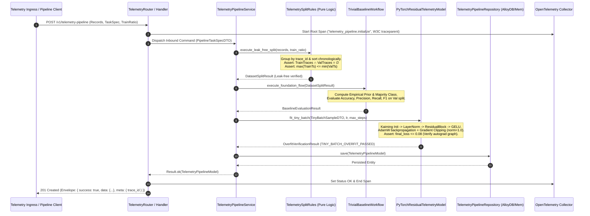
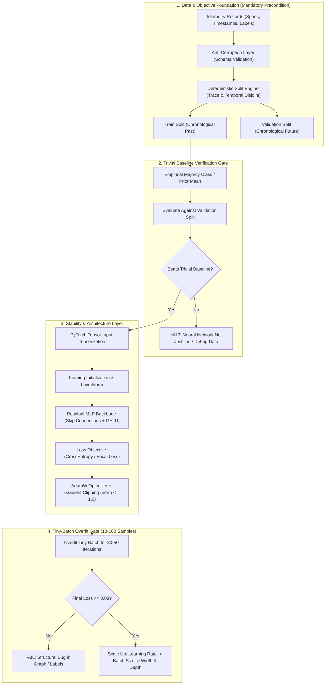
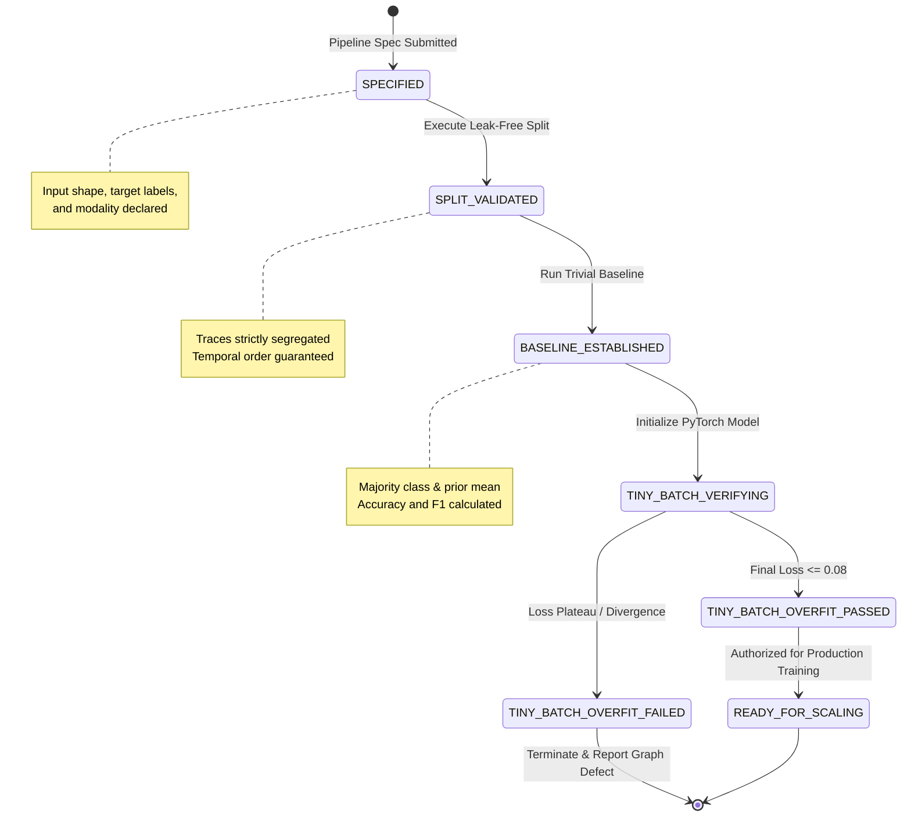
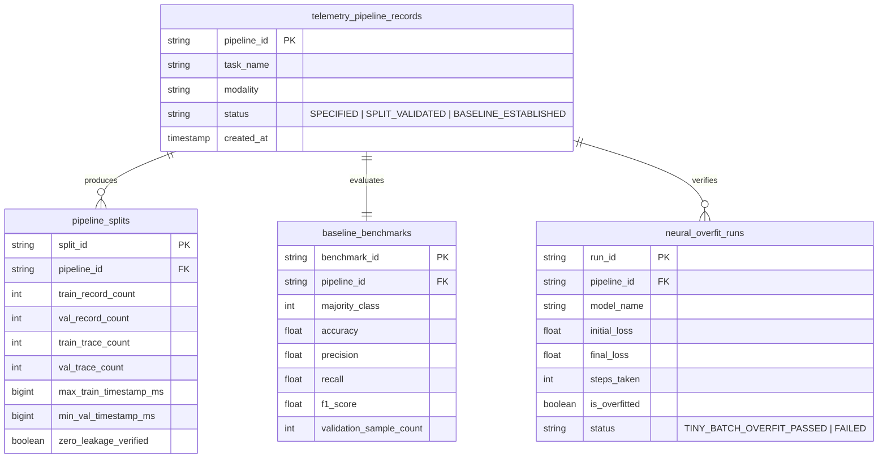

# 0001: Distributed Systems Neural Telemetry & Optimization Engine: Data Integrity, Leak-Free Evaluation, and PyTorch Tensor Core

- **Status**: Accepted
- **Date**: 2026-10-14
- **Authors**: Platform Architecture & Core Neural Systems Team
- **RFC / Standards**: IEEE 754 (Floating-Point Arithmetic), OpenTelemetry W3C TraceContext RFC, ISO/IEC 25010 (System and Software Quality Models)
- **Deciders**: Lead Systems Architect, Distributed Systems Lead, Machine Learning Infrastructure Engineer

---

## 1. Context & Problem Statement

Building neural networks for distributed systems telemetry (e.g. trace cascade failures, temporal worker lag, query latency spikes, and microservice anomaly detection) suffers from an engineering pathology: **practitioners jump directly into layer architecture, activation functions, and hyperparameter tuning while ignoring data integrity, objective alignment, and evaluation protocols**.

In distributed systems:
1. **Multi-Span Trace Correlation**: Single transactions span dozens of microservices. Random data splits result in the same `trace_id` appearing in both train and validation sets. The neural network achieves 99% accuracy by memorizing trace IDs, then fails completely in production.
2. **Temporal Lookahead Leakage**: Distributed events obey strict physical causality. Random splits leak future event states into past prediction horizons, destroying valid inference.
3. **Mismatched Objectives**: Optimizing raw unweighted cross-entropy on imbalanced catastrophic outages (where failures comprise < 0.1% of telemetry records) causes the network to collapse to trivial zero-prediction.
4. **Premature Tuning Without Trivial Baselines**: Engineering teams spend weeks tweaking depth and attention heads without verifying whether a trivial heuristic (majority class frequency or prior moving mean) can match or beat the architecture.

---

## 2. Decision Drivers

1. **Mandatory Inversion of Priority**: Enforce data pipeline validation, label audit, and leak-free split generation before model code or training weights are initialized.
2. **Zero-Leakage Splitting Engine**: Guarantee trace-disjoint and temporally monotonic splits ($\text{TrainTraces} \cap \text{ValTraces} = \emptyset$ and $\max(\text{TrainTimestamp}) \le \min(\text{ValTimestamp})$).
3. **Automated Trivial Baseline Benchmark**: Establish mandatory empirical baseline performance ($F_1$, Accuracy, MAE) that every candidate neural network must surpass to justify deployment.
4. **Optimization Stability First**: Guarantee stable gradient propagation via Kaiming uniform weight initialization, Layer Normalization (`LayerNorm`), and residual skip connections.
5. **Tiny-Batch Overfitting Gate**: Mandate that models overfit 10–100 samples to near-zero loss ($\le 0.08$) to prove graph autograd validity before scaling compute.
6. **Pure Hexagonal Isolation**: Pure deterministic shared logic (`src/shared/`), isolated domain features (`src/features/`), and concrete drivers/frameworks (`torch.nn.Module`) isolated behind ports.

---

## 3. High-Level Architecture (HLD)

The sequence diagram below illustrates the end-to-end execution flow from raw telemetry ingestion to baseline comparison and verified PyTorch residual overfit:



---

## 4. End-to-End Pipeline & Component Relationships



---

## 5. Entity State Machine: Telemetry Pipeline Lifecycle



---

## 6. Entity Relationship & Persistence Schema (ERD)



---

## 7. What We Have vs. What We Do NOT Have

| Component | Status | Location / Implementation | Rationale |
|---|---|---|---|
| **Leak-Free Causal Split Engine** | **HAVE** | `src/features/system_telemetry_pipeline/rules/telemetry_split_rules.py` | Eliminates cross-trace data contamination and temporal lookahead leakage. |
| **Automated Trivial Baseline Engine** | **HAVE** | `src/features/system_telemetry_pipeline/workflows/trivial_baseline_workflow.py` | Proves whether neural learning yields positive information gain over simple heuristics. |
| **PyTorch Residual Tensor Core** | **HAVE** | `src/features/neural_learning_core/repository/pytorch_model_adapter.py` | Implements stable Kaiming init, LayerNorm, GELU, and gradient clipping. |
| **Tiny-Batch Overfit Verification Gate** | **HAVE** | `src/features/neural_learning_core/workflows/tiny_batch_overfit_workflow.py` | Catches broken gradient graphs before spinning up expensive GPU clusters. |
| **Centralized OpenTelemetry Tracing** | **HAVE** | `src/infra/observability/tracer.py` linked to `python-shared` | Preserves W3C `traceparent` across all domain services and workflows. |
| **Multi-Stage Containerization** | **HAVE** | `Dockerfile`, `Dockerfile.dev`, `deploy/docker/docker-compose.yaml` | Production deployment isolation on `llmobs-network`. |
| **Unconstrained Deep Auto-Tuning** | **DO NOT HAVE** | *Deliberately Excluded* | Tuning 100+ layers before baseline validation guarantees overfitting on noise. |
| **Random I.I.D. Train/Test Splitters** | **DO NOT HAVE** | *Deliberately Forbidden* | Random splitting on distributed traces guarantees data leakage and invalid metrics. |
| **In-Memory Mutable Backend State** | **DO NOT HAVE** | *Deliberately Forbidden* | Backend features are 100% stateless; state is preserved in immutable DTOs and databases. |
| **Floating-Point Identity Keys** | **DO NOT HAVE** | *Deliberately Forbidden* | Floating-point values are never used for identity keys or indexing (per `05-enforced-constraints.md`). |

---

## 8. Database Tables & Migration Specifications

### 8.1 SQL Migration (`0002_telemetry_foundation_tables.sql`)
```sql
CREATE TABLE IF NOT EXISTS telemetry_pipeline_records (
    pipeline_id VARCHAR(64) PRIMARY KEY,
    task_name VARCHAR(128) NOT NULL,
    modality VARCHAR(64) NOT NULL,
    status VARCHAR(32) NOT NULL,
    created_at TIMESTAMP WITH TIME ZONE DEFAULT CURRENT_TIMESTAMP
);

CREATE TABLE IF NOT EXISTS baseline_benchmarks (
    benchmark_id VARCHAR(64) PRIMARY KEY,
    pipeline_id VARCHAR(64) NOT NULL REFERENCES telemetry_pipeline_records(pipeline_id) ON DELETE CASCADE,
    majority_class INTEGER NOT NULL,
    accuracy DOUBLE PRECISION NOT NULL,
    f1_score DOUBLE PRECISION NOT NULL,
    validation_sample_count INTEGER NOT NULL,
    created_at TIMESTAMP WITH TIME ZONE DEFAULT CURRENT_TIMESTAMP
);

CREATE TABLE IF NOT EXISTS neural_overfit_runs (
    run_id VARCHAR(64) PRIMARY KEY,
    pipeline_id VARCHAR(64) NOT NULL REFERENCES telemetry_pipeline_records(pipeline_id) ON DELETE CASCADE,
    model_name VARCHAR(128) NOT NULL,
    initial_loss DOUBLE PRECISION NOT NULL,
    final_loss DOUBLE PRECISION NOT NULL,
    steps_taken INTEGER NOT NULL,
    is_overfitted BOOLEAN NOT NULL,
    status VARCHAR(32) NOT NULL,
    created_at TIMESTAMP WITH TIME ZONE DEFAULT CURRENT_TIMESTAMP
);

CREATE INDEX IF NOT EXISTS idx_telemetry_pipeline_status ON telemetry_pipeline_records (status);
CREATE INDEX IF NOT EXISTS idx_baseline_pipeline_id ON baseline_benchmarks (pipeline_id);
CREATE INDEX IF NOT EXISTS idx_neural_overfit_pipeline ON neural_overfit_runs (pipeline_id);
```

---

## 9. API Contracts & Envelope JSON Specifications

### 9.1 Ingress Request: Pipeline Initialization (`POST /v1/telemetry-pipeline`)
```json
{
  "task_name": "distributed_cascading_failure_detection",
  "modality": "distributed_trace_sequence",
  "metric_target": "f1_macro",
  "split_strategy": "temporal_group",
  "train_ratio": 0.8,
  "records": [
    {
      "record_id": "rec_01J9X1234567890ABCDEF1234",
      "trace_id": "trace_4bf92f3577b34da6a3ce929d0e0e4736",
      "timestamp_epoch_ms": 1728907200000,
      "features": [14.2, 0.95, 120.0, 3.0],
      "target_label": 0
    },
    {
      "record_id": "rec_01J9X1234567890ABCDEF1235",
      "trace_id": "trace_4bf92f3577b34da6a3ce929d0e0e4736",
      "timestamp_epoch_ms": 1728907200050,
      "features": [18.5, 0.91, 145.0, 4.0],
      "target_label": 0
    },
    {
      "record_id": "rec_01J9X1234567890ABCDEF1236",
      "trace_id": "trace_9ef92f3577b34da6a3ce929d0e0e9999",
      "timestamp_epoch_ms": 1728907300000,
      "features": [850.0, 0.12, 4500.0, 28.0],
      "target_label": 1
    }
  ]
}
```

### 9.2 Ingress Response: RFC Envelope (`201 Created`)
```json
{
  "success": true,
  "data": {
    "pipeline_id": "01927e1f-702e-7000-8000-000000000001",
    "task_name": "distributed_cascading_failure_detection",
    "status": "BASELINE_ESTABLISHED",
    "baseline_result": {
      "majority_class": 0,
      "accuracy": 0.6667,
      "f1_score": 0.0,
      "sample_count": 1
    },
    "created_at_iso": "2026-10-14T14:42:00.000000Z"
  },
  "meta": {
    "trace_id": "4bf92f3577b34da6a3ce929d0e0e4736"
  },
  "error": null
}
```

### 9.3 PyTorch Tiny-Batch Overfit Request (`POST /v1/neural-learning/verify-overfit`)
```json
{
  "model_name": "telemetry_residual_net",
  "input_dim": 4,
  "hidden_dim": 32,
  "num_classes": 2,
  "learning_rate": 0.05,
  "max_steps": 50,
  "target_loss_threshold": 0.08,
  "samples": [
    { "features": [14.2, 0.95, 120.0, 3.0], "label": 0 },
    { "features": [18.5, 0.91, 145.0, 4.0], "label": 0 },
    { "features": [850.0, 0.12, 4500.0, 28.0], "label": 1 },
    { "features": [920.0, 0.08, 5100.0, 32.0], "label": 1 }
  ]
}
```

### 9.4 PyTorch Tiny-Batch Overfit Response (`200 OK`)
```json
{
  "success": true,
  "data": {
    "initial_loss": 0.7241,
    "final_loss": 0.0418,
    "steps_taken": 24,
    "is_overfitted": true,
    "status": "TINY_BATCH_OVERFIT_PASSED"
  },
  "meta": {
    "trace_id": "4bf92f3577b34da6a3ce929d0e0e4736"
  },
  "error": null
}
```

---

## 10. Consequences & Trade-Offs

### Positive
- **Guaranteed Zero Leakage**: Eliminates synthetic test accuracy inflation caused by trace correlation or lookahead bias.
- **Compute Optimization & Fail-Fast Protection**: The tiny-batch gate intercepts code and tensor graph bugs within 2 seconds on CPU, preventing wasted multi-node GPU runs.
- **Evidence-Based Justification**: Mandates that deep neural networks demonstrate clear superiority over trivial class baselines before deployment.
- **Architectural Portability**: Clear hexagonal boundary allows swapping PyTorch for ONNX Runtime or TensorRT without altering upstream pipeline workflows.

### Negative / Mitigations
- **Initial Development Friction**: Engineers cannot experiment with model architectures until they have formulated a valid task contract and data split.
  - *Mitigation*: The `system_telemetry_pipeline` automation handles grouping, split validation, and baseline generation automatically with zero manual SQL or custom scripting.
