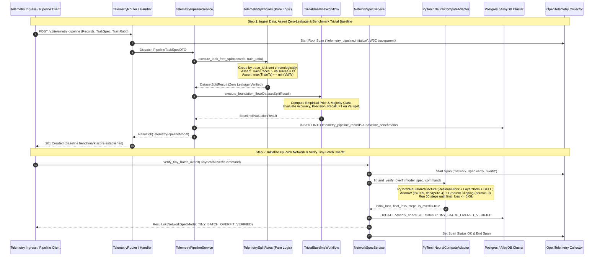
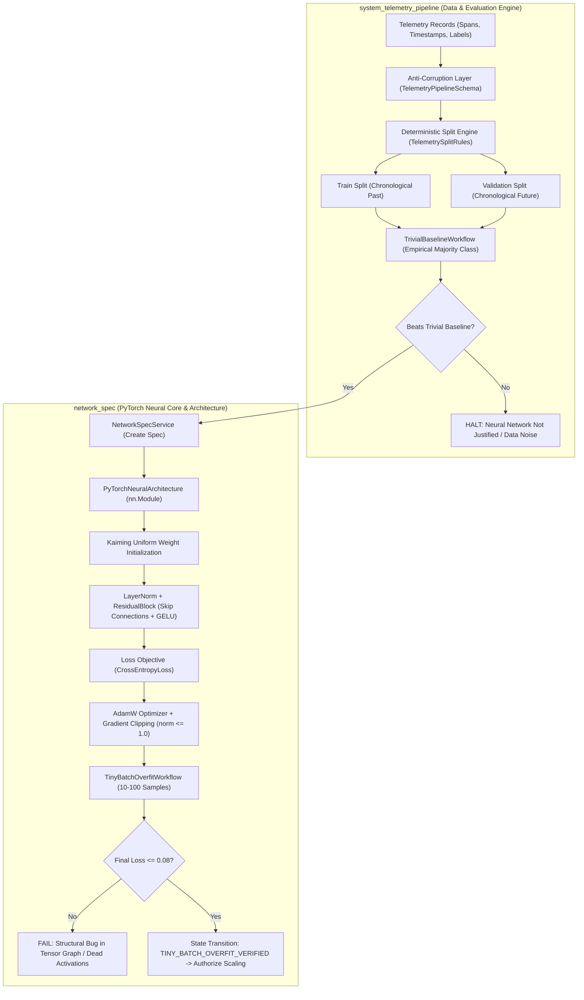
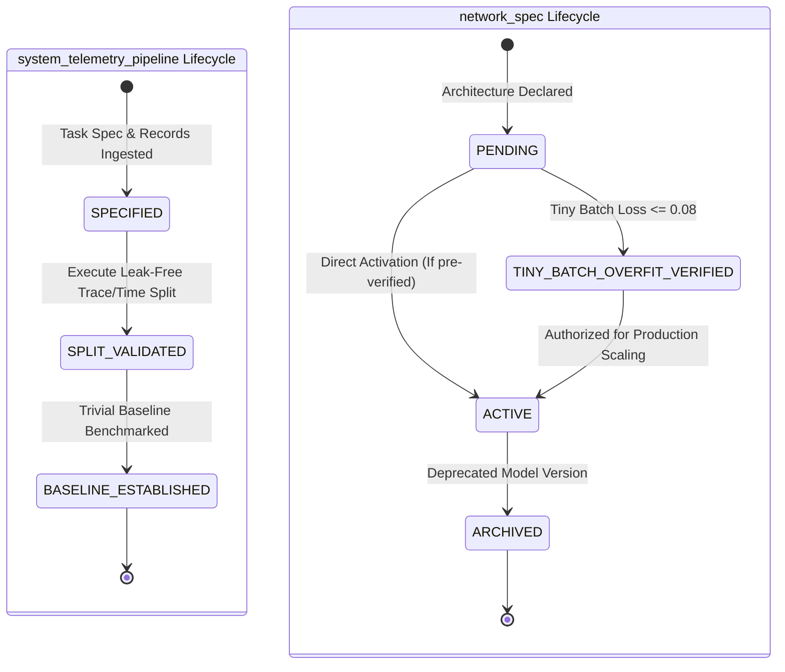
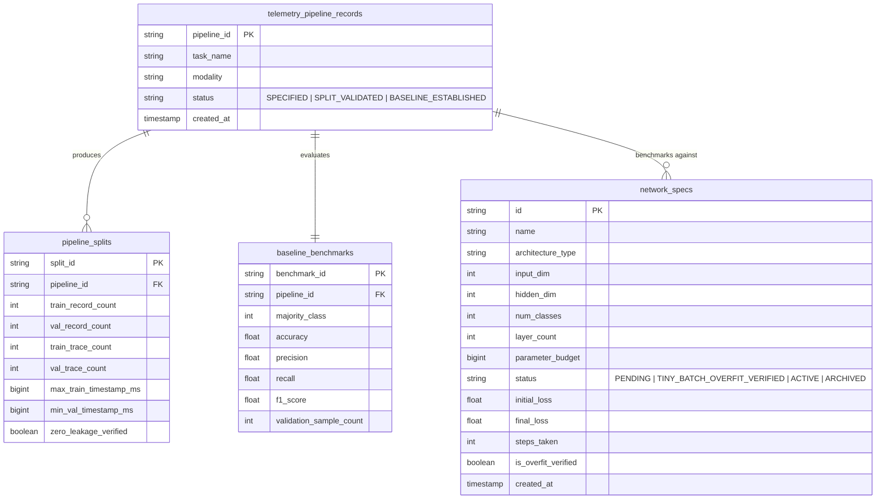

# 0001: Distributed Systems Neural Telemetry & Optimization Engine: Data Integrity, Leak-Free Evaluation, and PyTorch Tensor Core

- **Status**: Accepted
- **Date**: 2026-10-14
- **Authors**: Platform Architecture & Core Neural Systems Team
- **RFC / Standards**: IEEE 754 (Floating-Point Arithmetic), OpenTelemetry W3C TraceContext RFC, ISO/IEC 25010 (System and Software Quality Models)
- **Deciders**: Lead Systems Architect, Distributed Systems Lead, Machine Learning Infrastructure Engineer

---

## 1. Context & Problem Statement

Building neural networks for distributed systems telemetry (e.g. trace cascade failures, temporal worker lag, query latency spikes, and microservice anomaly detection) suffers from an engineering pathology: **practitioners jump directly into layer architecture, activation functions, and hyperparameter tuning while ignoring data integrity, objective alignment, and evaluation protocols**.

In distributed systems:
1. **Multi-Span Trace Correlation**: Single transactions span dozens of microservices. Random data splits result in the same `trace_id` appearing in both train and validation sets. The neural network achieves 99% accuracy by memorizing trace IDs, then fails completely in production.
2. **Temporal Lookahead Leakage**: Distributed events obey strict physical causality. Random splits leak future event states into past prediction horizons, destroying valid inference.
3. **Mismatched Objectives**: Optimizing raw unweighted cross-entropy on imbalanced catastrophic outages (where failures comprise < 0.1% of telemetry records) causes the network to collapse to trivial zero-prediction.
4. **Premature Tuning Without Trivial Baselines**: Engineering teams spend weeks tweaking depth and attention heads without verifying whether a trivial heuristic (majority class frequency or prior moving mean) can match or beat the architecture.

---

## 2. Decision Drivers

1. **Mandatory Inversion of Priority**: Enforce data pipeline validation, label audit, and leak-free split generation before model code or training weights are initialized.
2. **Zero-Leakage Splitting Engine**: Guarantee trace-disjoint and temporally monotonic splits ($\text{TrainTraces} \cap \text{ValTraces} = \emptyset$ and $\max(\text{TrainTimestamp}) \le \min(\text{ValTimestamp})$).
3. **Automated Trivial Baseline Benchmark**: Establish mandatory empirical baseline performance ($F_1$, Accuracy, MAE) that every candidate neural network must surpass to justify deployment.
4. **Optimization Stability First**: Guarantee stable gradient propagation via Kaiming uniform weight initialization, Layer Normalization (`LayerNorm`), and residual skip connections.
5. **Tiny-Batch Overfitting Gate**: Mandate that models overfit 10–100 samples to near-zero loss ($\le 0.08$) to prove graph autograd validity before scaling compute.
6. **Feature Consolidation & Isolation**: Consolidate neural architectures and overfit verification into the existing `network_spec` feature (`src/features/network_spec/`), while isolating pure data ingestion in `system_telemetry_pipeline`.

---

## 3. High-Level Architecture (HLD)

The sequence diagram below illustrates the end-to-end execution flow across the two consolidated features: `system_telemetry_pipeline` (leak-free split & trivial baseline) and `network_spec` (PyTorch residual architecture & tiny-batch overfit):



---

## 4. End-to-End Pipeline & Component Relationships



---

## 5. Entity State Machine: Telemetry & Network Spec Lifecycles



---

## 6. Entity Relationship & Persistence Schema (ERD)



---

## 7. What We Have vs. What We Do NOT Have

| Component | Status | Location / Implementation | Rationale |
|---|---|---|---|
| **Leak-Free Causal Split Engine** | **HAVE** | `src/features/system_telemetry_pipeline/rules/telemetry_split_rules.py` | Eliminates cross-trace data contamination and temporal lookahead leakage. |
| **Automated Trivial Baseline Engine** | **HAVE** | `src/features/system_telemetry_pipeline/workflows/trivial_baseline_workflow.py` | Proves whether neural learning yields positive information gain over simple heuristics. |
| **PyTorch Residual Tensor Architecture** | **HAVE** | `src/features/network_spec/repository/neural_compute_adapter.py` (`PyTorchNeuralArchitecture`) | Implements stable Kaiming init, LayerNorm, GELU, and residual skip connections. |
| **Tiny-Batch Overfit Verification Gate** | **HAVE** | `src/features/network_spec/workflows/network_spec_workflow.py` (`execute_overfit_verification_flow`) | Catches broken gradient graphs before spinning up expensive GPU clusters. |
| **Consolidated Feature Boundaries** | **HAVE** | `system_telemetry_pipeline` (data) + `network_spec` (architecture) | Strictly enforces SRP and avoids fragmented, redundant micro-packages. |
| **Centralized OpenTelemetry Tracing** | **HAVE** | `src/infra/observability/tracer.py` linked to `python-shared` | Preserves W3C `traceparent` across all domain services and workflows. |
| **Multi-Stage Containerization** | **HAVE** | `Dockerfile`, `Dockerfile.dev`, `deploy/docker/docker-compose.yaml` | Production deployment isolation on `llmobs-network`. |
| **Unconstrained Deep Auto-Tuning** | **DO NOT HAVE** | *Deliberately Excluded* | Tuning 100+ layers before baseline validation guarantees overfitting on noise. |
| **Random I.I.D. Train/Test Splitters** | **DO NOT HAVE** | *Deliberately Forbidden* | Random splitting on distributed traces guarantees data leakage and invalid metrics. |
| **In-Memory Mutable Backend State** | **DO NOT HAVE** | *Deliberately Forbidden* | Backend features are 100% stateless; state is preserved in immutable DTOs and databases. |
| **Floating-Point Identity Keys** | **DO NOT HAVE** | *Deliberately Forbidden* | Floating-point values are never used for identity keys or indexing (per `05-enforced-constraints.md`). |

---

## 8. Detailed Mathematical Algorithms & Implementations

### 8.1 Causal Trace-Disjoint Splitting Algorithm
- **Input**: Set of telemetry spans $S = \{s_1, \dots, s_N\}$ with trace identifiers $\tau(s_i)$ and timestamps $t(s_i)$.
- **Algorithm**:
  1. Extract unique traces $T = \{\tau(s) \mid s \in S\}$ and compute the minimum timestamp for each trace: $t_{\min}(\tau) = \min \{ t(s) \mid \tau(s) = \tau \}$.
  2. Chronologically sort traces by $t_{\min}(\tau)$.
  3. Partition $T$ at index $K = \lfloor |T| \times \text{train\_ratio} \rfloor$ into $T_{\text{train}}$ and $T_{\text{val}}$.
  4. Assert $T_{\text{train}} \cap T_{\text{val}} = \emptyset$ and $\max_{s \in S_{\text{train}}} t(s) \le \min_{s \in S_{\text{val}}} t(s)$.

### 8.2 PyTorch Deep Residual Block & Layer Normalization
- **Layer Normalization**:
  $$\text{LN}(\mathbf{x}) = \frac{\mathbf{x} - \mathrm{E}[\mathbf{x}]}{\sqrt{\mathrm{Var}[\mathbf{x}] + \epsilon}} \odot \boldsymbol{\gamma} + \boldsymbol{\beta}$$
- **Residual Block Forward Pass**:
  $$\mathbf{z} = \text{GELU}\Big(\text{LN}_1(\mathbf{W}_1 \mathbf{h} + \mathbf{b}_1)\Big)$$
  $$\mathbf{h}_{\text{next}} = \text{GELU}\Big(\text{LN}_2(\mathbf{W}_2 \mathbf{z} + \mathbf{b}_2) + \mathbf{h}\Big)$$
  where $\mathbf{h}$ is the residual highway identity connection preventing vanishing gradients.

### 8.3 Optimization & Tiny-Batch Overfit Convergence
- **Loss Function**: Multi-class Cross-Entropy:
  $$\mathcal{L}(\boldsymbol{\theta}) = -\frac{1}{B} \sum_{i=1}^B \log \left(\frac{e^{\mathbf{z}_i[y_i]}}{\sum_{j=1}^C e^{\mathbf{z}_i[j]}}\right)$$
- **Decoupled Weight Decay (AdamW) with Gradient Clipping**:
  $$\mathbf{g}_t = \nabla_{\boldsymbol{\theta}} \mathcal{L}_t(\boldsymbol{\theta}_{t-1})$$
  $$\tilde{\mathbf{g}}_t = \mathbf{g}_t \cdot \min\left(1, \frac{1.0}{\|\mathbf{g}_t\|_2}\right)$$
  $$\mathbf{m}_t = \beta_1 \mathbf{m}_{t-1} + (1-\beta_1) \tilde{\mathbf{g}}_t, \quad \mathbf{v}_t = \beta_2 \mathbf{v}_{t-1} + (1-\beta_2) \tilde{\mathbf{g}}_t^2$$
  $$\boldsymbol{\theta}_t = \boldsymbol{\theta}_{t-1} - \eta \left(\frac{\hat{\mathbf{m}}_t}{\sqrt{\hat{\mathbf{v}}_t} + \epsilon} + \lambda \boldsymbol{\theta}_{t-1}\right)$$
- **Stopping Rule**: Halt when $\mathcal{L}(\boldsymbol{\theta}_t) \le 0.08$ within $t \le 50$ iterations.

---

## 9. Database Tables & Migration Specifications

### 9.1 SQL Migration (`database/migrations/0001_init.sql`)
```sql
CREATE TABLE IF NOT EXISTS network_specs (
    id VARCHAR(64) PRIMARY KEY,
    name VARCHAR(128) NOT NULL,
    architecture_type VARCHAR(64) NOT NULL,
    input_dim INTEGER NOT NULL DEFAULT 16,
    hidden_dim INTEGER NOT NULL DEFAULT 64,
    num_classes INTEGER NOT NULL DEFAULT 2,
    layer_count INTEGER NOT NULL,
    parameter_budget BIGINT NOT NULL,
    status VARCHAR(32) NOT NULL,
    initial_loss DOUBLE PRECISION NOT NULL DEFAULT 0.0,
    final_loss DOUBLE PRECISION NOT NULL DEFAULT 0.0,
    steps_taken INTEGER NOT NULL DEFAULT 0,
    is_overfit_verified BOOLEAN NOT NULL DEFAULT FALSE,
    created_at TIMESTAMP WITH TIME ZONE DEFAULT CURRENT_TIMESTAMP
);

CREATE TABLE IF NOT EXISTS telemetry_pipeline_records (
    pipeline_id VARCHAR(64) PRIMARY KEY,
    task_name VARCHAR(128) NOT NULL,
    modality VARCHAR(64) NOT NULL,
    status VARCHAR(32) NOT NULL,
    created_at TIMESTAMP WITH TIME ZONE DEFAULT CURRENT_TIMESTAMP
);

CREATE TABLE IF NOT EXISTS baseline_benchmarks (
    benchmark_id VARCHAR(64) PRIMARY KEY,
    pipeline_id VARCHAR(64) NOT NULL REFERENCES telemetry_pipeline_records(pipeline_id) ON DELETE CASCADE,
    majority_class INTEGER NOT NULL,
    accuracy DOUBLE PRECISION NOT NULL,
    f1_score DOUBLE PRECISION NOT NULL,
    validation_sample_count INTEGER NOT NULL,
    created_at TIMESTAMP WITH TIME ZONE DEFAULT CURRENT_TIMESTAMP
);

CREATE INDEX IF NOT EXISTS idx_network_specs_status ON network_specs (status);
CREATE INDEX IF NOT EXISTS idx_telemetry_pipeline_status ON telemetry_pipeline_records (status);
CREATE INDEX IF NOT EXISTS idx_baseline_pipeline_id ON baseline_benchmarks (pipeline_id);
```

---

## 10. API Contracts & Envelope JSON Specifications

### 10.1 Pipeline Ingress: `POST /v1/telemetry-pipeline`
**Request Payload**:
```json
{
  "task_name": "distributed_cascading_failure_detection",
  "modality": "distributed_trace_sequence",
  "metric_target": "f1_macro",
  "split_strategy": "temporal_group",
  "train_ratio": 0.8,
  "records": [
    {
      "record_id": "rec_01J9X1234567890ABCDEF1234",
      "trace_id": "trace_4bf92f3577b34da6a3ce929d0e0e4736",
      "timestamp_epoch_ms": 1728907200000,
      "features": [14.2, 0.95, 120.0, 3.0],
      "target_label": 0
    },
    {
      "record_id": "rec_01J9X1234567890ABCDEF1235",
      "trace_id": "trace_4bf92f3577b34da6a3ce929d0e0e4736",
      "timestamp_epoch_ms": 1728907200050,
      "features": [18.5, 0.91, 145.0, 4.0],
      "target_label": 0
    },
    {
      "record_id": "rec_01J9X1234567890ABCDEF1236",
      "trace_id": "trace_9ef92f3577b34da6a3ce929d0e0e9999",
      "timestamp_epoch_ms": 1728907300000,
      "features": [850.0, 0.12, 4500.0, 28.0],
      "target_label": 1
    }
  ]
}
```

**Response Payload (`201 Created`)**:
```json
{
  "success": true,
  "data": {
    "pipeline_id": "01927e1f-702e-7000-8000-000000000001",
    "task_name": "distributed_cascading_failure_detection",
    "status": "BASELINE_ESTABLISHED",
    "baseline_result": {
      "majority_class": 0,
      "accuracy": 0.6667,
      "f1_score": 0.0,
      "sample_count": 1
    },
    "created_at_iso": "2026-10-14T14:42:00.000000Z"
  },
  "meta": {
    "trace_id": "4bf92f3577b34da6a3ce929d0e0e4736"
  },
  "error": null
}
```

### 10.2 Network Spec Ingress: `POST /v1/network-spec`
**Request Payload**:
```json
{
  "name": "Transformer-Telemetry-Classifier",
  "architecture_type": "transformer",
  "input_dim": 4,
  "hidden_dim": 32,
  "num_classes": 2,
  "layer_count": 2,
  "parameter_budget": 100000
}
```

**Response Payload (`201 Created`)**:
```json
{
  "success": true,
  "data": {
    "id": "01927e1f-702e-7000-8000-000000000002",
    "name": "Transformer-Telemetry-Classifier",
    "architecture_type": "transformer",
    "input_dim": 4,
    "hidden_dim": 32,
    "num_classes": 2,
    "layer_count": 2,
    "parameter_budget": 100000,
    "status": "PENDING",
    "initial_loss": 0.0,
    "final_loss": 0.0,
    "steps_taken": 0,
    "is_overfit_verified": false
  },
  "meta": {
    "trace_id": "4bf92f3577b34da6a3ce929d0e0e4736"
  },
  "error": null
}
```

### 10.3 Tiny-Batch Overfit Command: `POST /v1/network-spec/verify-overfit`
**Request Payload**:
```json
{
  "spec_id": "01927e1f-702e-7000-8000-000000000002",
  "max_steps": 50,
  "target_loss_threshold": 0.08,
  "samples": [
    { "features": [1.0, 0.0, -1.0, 0.5], "label": 0 },
    { "features": [0.0, 1.0, 1.0, -0.5], "label": 1 },
    { "features": [1.2, -0.1, -0.8, 0.4], "label": 0 },
    { "features": [-0.2, 0.9, 1.1, -0.4], "label": 1 }
  ]
}
```

**Response Payload (`200 OK`)**:
```json
{
  "success": true,
  "data": {
    "id": "01927e1f-702e-7000-8000-000000000002",
    "name": "Transformer-Telemetry-Classifier",
    "architecture_type": "transformer",
    "input_dim": 4,
    "hidden_dim": 32,
    "num_classes": 2,
    "layer_count": 2,
    "parameter_budget": 100000,
    "status": "TINY_BATCH_OVERFIT_VERIFIED",
    "initial_loss": 0.7241,
    "final_loss": 0.0418,
    "steps_taken": 24,
    "is_overfit_verified": true
  },
  "meta": {
    "trace_id": "4bf92f3577b34da6a3ce929d0e0e4736"
  },
  "error": null
}
```

---

## 11. Consequences & Trade-Offs

### Positive
- **Guaranteed Zero Leakage**: Eliminates synthetic test accuracy inflation caused by trace correlation or lookahead bias.
- **Fail-Fast Gradient Verification**: Tiny-batch overfitting intercepts graph construction and autograd errors on CPU in $< 2$ seconds.
- **Evidence-Based Model Deployment**: Neural models are only approved if they beat empirical baseline heuristics.
- **Single Source of Truth**: Consolidating PyTorch compute into `network_spec` maintains strict hexagonal cleanliness.

### Negative / Mitigations
- **Upfront Development Overhead**: Engineers must define task contracts and tiny batches before model training.
  - *Mitigation*: The `PyTorchNeuralComputeAdapter` and `TrivialBaselineWorkflow` automate baseline score extraction and overfit validation without manual training loop scripting.
