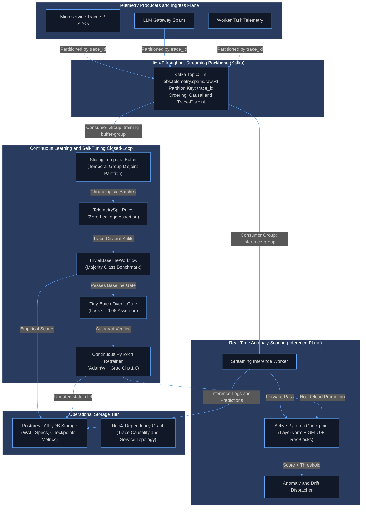
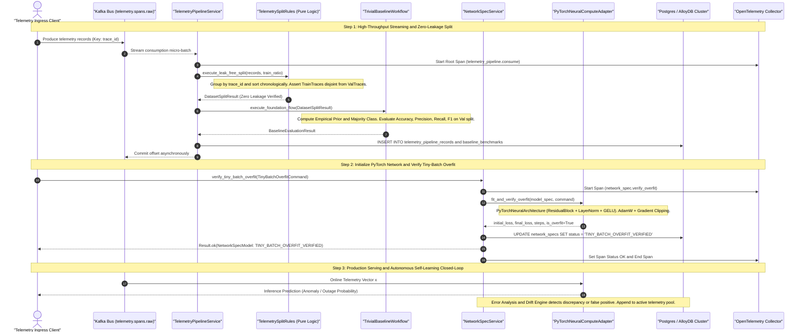
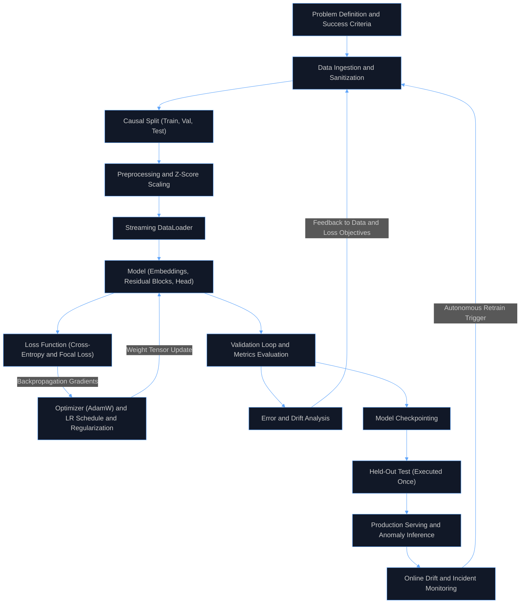
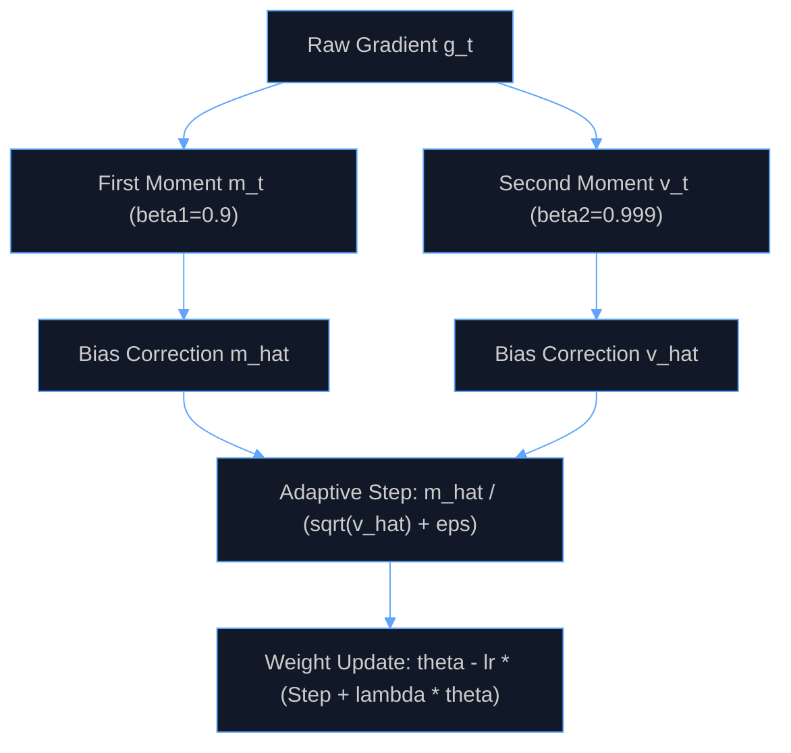
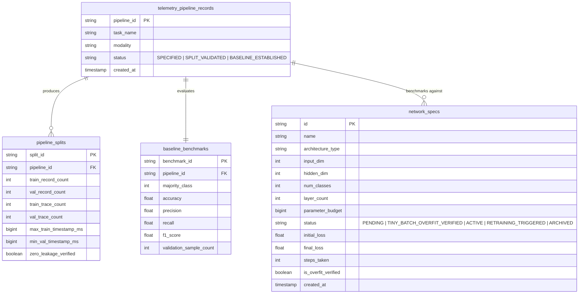

# 0001: Distributed Systems Telemetry and Neural Network : An Architecture Decision Record (ADR)

- **Status**: Accepted
- **Date**: 2026-10-14
- **Authors**: Platform Architecture and Core Neural Systems Team
- **RFC / Standards**: IEEE 754 (Floating-Point Arithmetic), OpenTelemetry W3C TraceContext RFC, ISO/IEC 25010 (System and Software Quality Models)
- **Deciders**: Lead Systems Architect, Distributed Systems Lead, Machine Learning Infrastructure Engineer

---

## 1. Context and Problem Statement

Building neural networks for distributed systems telemetry (e.g. trace cascade failures, temporal worker lag, query latency spikes, and microservice anomaly detection) suffers from an engineering pathology: **practitioners jump directly into layer architecture, activation functions, and hyperparameter tuning while ignoring data integrity, objective alignment, and evaluation protocols**.

In distributed systems:
1. **Multi-Span Trace Correlation**: Single transactions span dozens of microservices. Random data splits result in the same `trace_id` appearing in both train and validation sets. The neural network achieves 99% accuracy by memorizing trace IDs, then fails completely in production.
2. **Temporal Lookahead Leakage**: Distributed events obey strict physical causality. Random splits leak future event states into past prediction horizons, destroying valid inference.
3. **Mismatched Objectives**: Optimizing raw unweighted cross-entropy on imbalanced catastrophic outages (where failures comprise < 0.1% of telemetry records) causes the network to collapse to trivial zero-prediction.
4. **Premature Tuning Without Trivial Baselines**: Engineering teams spend weeks tweaking depth and attention heads without verifying whether a trivial heuristic (majority class frequency or prior moving mean) can match or beat the architecture.
5. **Absence of Autonomous Self-Learning Feedback Loop**: Models deployed in production degrade as service topologies evolve. Without an automated continuous closed-loop that captures errors, monitors drift, validates candidate checkpoints against baseline gates, and triggers retraining, models become stale and dangerous.

---

## 2. Decision Drivers and Core Principles

1. **Mandatory Inversion of Priority**: Enforce data pipeline validation, label audit, and leak-free split generation before model code or training weights are initialized.
2. **Zero-Leakage Splitting Engine**: Guarantee trace-disjoint and temporally monotonic splits ($\text{TrainTraces} \cap \text{ValTraces} = \emptyset$ and $\max(\text{TrainTimestamp}) \le \min(\text{ValTimestamp})$).
3. **Automated Trivial Baseline Benchmark**: Establish mandatory empirical baseline performance ($F_1$, Accuracy, MAE) that every candidate neural network must surpass to justify deployment.
4. **Optimization Stability First**: Guarantee stable gradient propagation via Kaiming uniform weight initialization, Layer Normalization (`LayerNorm`), and residual skip connections.
5. **Tiny-Batch Overfitting Gate**: Mandate that models overfit 10–100 samples to near-zero loss ($\le 0.08$) to prove graph autograd validity before scaling compute.
6. **Continuous Autonomous Self-Learning Closed-Loop**: Telemetry inference errors, prediction drift, and production ground-truth discrepancies continuously feed back into the dataset repository, trigger automated re-benchmarking against the trivial baseline, and drive autonomous retraining.
7. **Feature Consolidation and Isolation**: Consolidate neural architectures and overfit verification into the existing `network_spec` feature (`src/features/network_spec/`), while isolating pure data ingestion in `system_telemetry_pipeline`.

---

## 3. High-Level Architecture (HLD)

The High-Level Architecture establishes a resilient, decoupled data-plane and control-plane division. Continuous telemetry ingestion is driven by an asynchronous Apache Kafka streaming bus partitioned by `trace_id` to guarantee physical causal ordering and eliminate HTTP connection overhead. Model management, tiny-batch overfit certification, and baseline configurations are served by the REST API control plane.

### 3.1 High-Level Architecture Diagram



---

## 3.3 Low-Level Architecture (LLD) and Subsystem Internals

The low-level design maps hexagonal architectural boundaries across ports, adapters, pure rules, domain workflows, and storage adapters.

### 3.3.1 Component Interaction and Class Topology

```mermaid
%%{init: {'theme': 'dark', 'themeVariables': { 'primaryColor': '#1E293B', 'primaryBorderColor': '#38BDF8', 'primaryTextColor': '#F1F5F9', 'lineColor': '#38BDF8', 'secondaryColor': '#064E3B', 'tertiaryColor': '#78350F', 'mainBkg': '#0F172A', 'nodeBorder': '#38BDF8'}}}%%
classDiagram
    direction TB

    class KafkaProducerPort {
        <<interface>>
        +produce(topic: str, key: str, value: bytes, headers: Mapping)~void~
        +flush(timeout: float)~void~
    }

    class KafkaConsumerPort {
        <<interface>>
        +subscribe(topics: list[str])~void~
        +poll(timeout: float)~object~
        +commit(asynchronous: bool)~void~
        +close()~void~
    }

    class KafkaConsumerAdapter {
        -Consumer _consumer
        -list[str] _topics
        +subscribe(topics: list[str])~void~
        +poll(timeout: float)~Message~
        +commit(asynchronous: bool)~void~
    }

    class TelemetrySplitRules {
        <<pure-function>>
        +execute_leak_free_split(records: Sequence, train_ratio: float)~DatasetSplitResult~
        +validate_zero_leakage(train: Sequence, val: Sequence)~bool~
    }

    class TrivialBaselineWorkflow {
        -TelemetryPipelineRepositoryPort _repo
        +execute_foundation_flow(ctx: TraceContext, dto: PipelineTaskSpecDTO)~TelemetryPipelineModel~
    }

    class PyTorchNeuralArchitecture {
        -nn.Linear _input_proj
        -nn.ModuleList _blocks
        -nn.Linear _head
        +forward(x: Tensor)~Tensor~
    }

    class PyTorchNeuralComputeAdapter {
        -PyTorchNeuralArchitecture _model
        -AdamW _optimizer
        +fit_and_verify_overfit(spec: NetworkSpecModel, cmd: TinyBatchOverfitCommand)~TinyBatchOverfitResult~
        +forward_eval(features: Tensor)~Tensor~
    }

    class NetworkSpecService {
        -NetworkSpecRepositoryPort _repo
        -NeuralComputePort _compute
        +create_network_spec(ctx: TraceContext, dto: NetworkSpecCreateDTO)~Result~
        +verify_tiny_batch_overfit(ctx: TraceContext, cmd: TinyBatchOverfitCommand)~Result~
    }

    KafkaConsumerPort <|.. KafkaConsumerAdapter : implements
    KafkaProducerPort <|.. KafkaProducerAdapter : implements
    TelemetryPipelineService --> TelemetrySplitRules : calls
    TelemetryPipelineService --> TrivialBaselineWorkflow : delegates
    NetworkSpecService --> PyTorchNeuralComputeAdapter : orchestrates
    PyTorchNeuralComputeAdapter --> PyTorchNeuralArchitecture : computes
```



---

## 3.4 Ingress Execution Flow and End-to-End Sequence



---

## 4. End-to-End Pipeline and Component Relationships (The Complete Learning Loop)

The end-to-end learning loop operates as a closed cybernetic system where telemetry streams flow through continuous evaluation, and validation metrics directly govern the training and data selection phases.

### 4.1 End-to-End Pipeline Diagram




### Detailed Component Relationships
- **Loss defines the gradient signal**, and the **optimizer decides how that signal moves the weights**.
- **Normalization and initialization keep gradients flowing** so the optimizer can operate stably.
- **Validation results flow back into the data and the loss**. The loop is the primary engine, not any isolated architecture block.
- **The test set is touched once**. Reusing it turns it into a validation set and destroys generalization evidence.
- **Self-Learning Trigger**: When online monitoring detects statistical drift (Kolmogorov-Smirnov or population stability index shift) or high loss on newly resolved incidents, the system cycles back to the data collection and causal split stage without manual intervention.

### 4.2 End-to-End System Decision Tree

This ASCII decision tree defines the deterministic logic gates executed across every phase of ingestion, verification, training, and production promotion:

```text
[ START: Ingress Telemetry Micro-Batch Received ]
  |
  +--> [ Gate 1: Network Spec Budget Validation ]
  |      |
  |      +-- (layer_count > 500 AND parameter_budget < 1,000,000) ?
  |      |     |
  |      |     +-- [YES] --> [ ACTION: Raise ValidationError ]
  |      |                   Status: REJECTED
  |      |                   Log: Parameter density too high for requested budget
  |      |                   TERMINATE
  |      |
  |      +-- [NO]  --> [ Proceed to Step 2 ]
  |
  +--> [ Step 2: Streaming Ingestion and Cryptographic Hashing ]
  |      |
  |      +--> Consume batch from Kafka topic: "telemetry.spans.raw"
  |      +--> Extract W3C TraceContext ('traceparent', 'x-request-id')
  |      +--> Parse into immutable Sequence[TelemetryRecordDTO]
  |
  +--> [ Gate 3: Causal Integrity and Trace-Boundary Isolation ]
  |      |
  |      +-- TrainTraces INTERSECT ValTraces != EMPTY ?
  |      |     |
  |      |     +-- [YES] --> [ ACTION: Raise LeakageDetectedError ]
  |      |                   Log: Contamination detected. Same trace_id in Train and Val.
  |      |                   HALT PIPELINE
  |      |
  |      +-- max(TrainTimestamp) > min(ValTimestamp) ?
  |      |     |
  |      |     +-- [YES] --> [ ACTION: Raise LeakageDetectedError ]
  |      |                   Log: Physical causality violation. Temporal lookahead detected.
  |      |                   HALT PIPELINE
  |      |
  |      +-- [NO]  --> [ Proceed to Step 4: Zero Leakage Confirmed ]
  |
  +--> [ Step 4: Trivial Empirical Baseline Benchmark ]
  |      |
  |      +--> Compute empirical prior on training split:
  |      |      Majority Class = argmax(count(y_train == c))
  |      |      Rolling Mean Latency = sum(latency) / N
  |      +--> Evaluate dummy heuristic predictor on validation split
  |      +--> Record Baseline Metrics: { Baseline_Accuracy, Baseline_F1, Baseline_MAE }
  |      +--> Persist baseline benchmark record to database
  |
  +--> [ Gate 5: Tiny-Batch Autograd and Gradient Flow Gate ]
  |      |
  |      +--> Extract 10 to 100 calibration samples
  |      +--> Initialize PyTorch Neural Core (Kaiming uniform weights, LayerNorm, GELU)
  |      +--> Execute 50 epochs of backpropagation on calibration batch
  |      |
  |      +-- final_loss <= 0.08 ?
  |      |     |
  |      |     +-- [NO]  --> [ ACTION: Flag Broken Graph ]
  |      |                   Log: Gradient flow failure, dead activations, or bad LR.
  |      |                   HALT TRAINING (Do not scale compute)
  |      |
  |      +-- [YES] --> [ STATUS: TINY_BATCH_OVERFIT_VERIFIED ]
  |                    Proceed to Step 6
  |
  +--> [ Step 6: Multi-Epoch Production Dataset Training ]
  |      |
  |      +--> Construct TensorDataset and batched DataLoader (shuffle=True)
  |      +--> Loop epochs (1 .. E):
  |      |      +--> Forward pass: encoder -> residual blocks -> linear classification head
  |      |      +--> Compute loss: CrossEntropyLoss or FocalLoss
  |      |      +--> Backward pass: compute adjoint gradients (loss.backward())
  |      |      +--> Apply gradient clipping: clip_grad_norm_(max_norm=1.0)
  |      |      +--> Optimizer update: AdamW step with weight decay (1e-4)
  |      +--> Evaluate validation split under torch.no_grad()
  |      +--> Compute Val_Loss, Val_Accuracy, Val_F1
  |
  +--> [ Gate 7: Trivial Baseline Promotion Gate ]
  |      |
  |      +-- (Candidate_Val_F1 <= Baseline_F1) OR (Candidate_Val_Loss >= Baseline_Loss) ?
  |      |     |
  |      |     +-- [YES] --> [ ACTION: Discard Neural Candidate ]
  |      |                   Log: Neural network failed to outperform trivial heuristic.
  |      |                   Route 100% production traffic to classical baseline.
  |      |                   TERMINATE
  |      |
  |      +-- [NO]  --> [ ACTION: Promote Candidate Checkpoint ]
  |                    Atomically write weights to disk: f"{spec_id}.pt"
  |                    Compute cryptographic SHA-256 integrity digest
  |                    Transition State Machine: STATUS_PENDING/OVERFIT -> STATUS_TRAINED -> STATUS_ACTIVE
  |
  +--> [ Step 8: Two-Tier Hybrid Production Inference ]
  |      |
  |      +--> Inbound streaming telemetry span arrived at wire speed
  |      +--> Tier 1 (CPU Fast-Path): Evaluate streaming EWMA / CUSUM / quantiles
  |      |
  |      +-- Is span ambiguous or multi-service root cause candidate?
  |      |     |
  |      |     +-- [NO]  --> Emit Fast-Path prediction (Latency < 15 microseconds)
  |      |     +-- [YES] --> Invoke Tier 2 Active PyTorch Tensor Checkpoint
  |      |                   Emit Deep Contextual Anomaly Probability
  |
  +--> [ Gate 9: Streaming Concept Drift and Incident Monitoring ]
         |
         +--> Compute Kolmogorov-Smirnov and PSI tests on rolling telemetry windows
         |
         +-- Drift Detected (p < 0.01) OR High Incident False-Positive Rate ?
               |
               +-- [NO]  --> Continue Serving
               +-- [YES] --> [ ACTION: Autonomous Trigger Closed-Loop ]
                             Append edge-case incidents to dataset pool
                             Loop back to Step 2 (Autonomous Retrain Cycle)
```

### 4.3 End-to-End Runtime Function Call Stack

The table below catalogs the exact, deterministic call stack executed by the engine from ingress to weight serialization:

| Level | Subsystem / Layer | Function / Method Signature | Exact Execution Responsibility |
| :--- | :--- | :--- | :--- |
| **1. Delivery** | API Router & Handler | `POST /v1/network-spec/train` -> `NetworkSpecHandler.handle_train_dataset(ctx, payload)` | Deserializes request payload, extracts W3C trace context, and invokes domain service. |
| **2. Schema** | Schema Layer | `NetworkSpecSchema.parse_training_command(payload)` | Validates parameter bounds, creates immutable typed `DatasetTrainingCommand` instances. |
| **3. Service** | Domain Service | `NetworkSpecService.train_dataset(ctx, command)` | Starts OpenTelemetry child span (`network_spec.train_dataset`), wraps workflow in structured try/catch/finally. |
| **4. Workflow** | Orchestration Flow | `NetworkSpecWorkflow.execute_dataset_training_flow(ctx, command)` | Retrieves existing spec from repository, orchestrates compute adapter, and enforces state machine transitions. |
| **5. Port** | Driven Port Contract | `NeuralComputePort.fit_dataset(...)` | Abstract contract boundary isolating domain logic from the underlying PyTorch tensor engine. |
| **6. Adapter** | PyTorch Adapter | `PyTorchNeuralComputeAdapter.fit_dataset(...)` | Builds PyTorch module, initialises AdamW optimizer, streams DataLoader minibatches, and computes epoch gradients. |
| **7. Architecture** | PyTorch Core | `PyTorchNeuralArchitecture.forward(x)` | Applies sequential encoder projection, LayerNorm, GELU, and residual blocks to produce output logits. |
| **8. Backprop** | PyTorch Autograd | `loss.backward()` & `nn.utils.clip_grad_norm_(net.parameters(), max_norm=1.0)` | Computes backward adjoint derivatives across all parameter tensors and clips gradient explosions. |
| **9. Optimizer** | PyTorch Optimizer | `optimizer.step()` & `optimizer.zero_grad()` | Updates weight tensors using momentum and decoupled weight decay ($W_{t+1} = W_t - \eta \nabla L - \lambda W_t$). |
| **10. Validation** | Evaluation Engine | `torch.no_grad()` & `criterion(val_logits, y_val)` | Evaluates generalization error and multiclass accuracy on strictly held-out validation tensors. |
| **11. Storage** | Persistence & Hashing | `torch.save(...)` & `hashlib.sha256().hexdigest()` | Atomically writes `.pt` checkpoint file with model weights, optimizer state, and returns verified SHA-256 digest. |
| **12. State Machine**| Pure Transition Machine | `NetworkSpecMachine.transition(current_state, "TRAINED")` | Deterministically transitions specification state to `STATUS_TRAINED` and commits update to repository. |

---

## 5. Most Critical Parts, Ranked

1. **Data and Labels**: Quantity, label noise, leakage, and distribution match with production.
2. **Objective and Metric Alignment**: The surrogate loss you optimize must monotonically track the business and evaluation metric you are judged on.
3. **Evaluation Protocol**: A held-out split that mirrors real use (temporal, group-based, or cluster-based splits; never random splits when records correlate).
4. **Optimization Stability**: Initialization, normalization, learning rate, and schedule. A wrong learning rate alone can make a good architecture fail.
5. **Architecture**: Matters least until items 1 through 4 are solid. Pretrained backbones and standard residual blocks consistently beat custom unverified designs.

---

## 6. How to Design and Train One (The 6-Step Process)

1. **Define Task and Baseline**: Define input and output tensor shapes and success metric, plus a trivial baseline (majority class, heuristic, linear model, or gradient-boosted trees). If you cannot beat the baseline, the neural network is not the answer.
2. **Build the Pipeline First**: Build the data pipeline, deduplication, and leak-free split before touching any model code.
3. **Start with Proven Architecture**: Use proven architectures for the modality (residual MLP for tabular telemetry vectors, Transformer for token sequences).
4. **Overfit a Tiny Batch**: Overfit a tiny batch (10 to 100 samples) to near-zero loss ($\le 0.08$). If it cannot, you have a structural bug (dead activations, broken autograd, target mismatch), not a tuning problem.
5. **Scale Up and Tune Systematically**: Tune strictly in this order:
   $$\text{Learning Rate} \longrightarrow \text{Batch Size} \longrightarrow \text{Regularization} \longrightarrow \text{Width and Depth}$$
6. **Run Error Analysis**: Analyze failure modes and false positives, feeding edge-case telemetry back into the training distribution.

---

## 7. Critical Algorithms Implemented in the Engine

### 7.1 Learning Core

#### 7.1.1 Reverse-Mode Automatic Differentiation (Backpropagation)

##### 1. Non-Technical Definition
Think of baking a cake using a sequence of five steps. If the cake turns out too salty, you need to know exactly how much each teaspoon of salt contributed to that bad taste. Backpropagation is the mathematical process of starting at the final mistake (the loss) and tracing backward step by step through every instruction to tell each ingredient exactly how much it needs to change.

##### 2. Technical Definition
Reverse-mode automatic differentiation applies the multivariate chain rule from output loss scalar $L$ back to all model parameter tensors $\mathbf{W}_l$:
$$\frac{\partial L}{\partial \mathbf{W}_l} = \frac{\partial L}{\partial \mathbf{a}_l} \cdot \frac{\partial \mathbf{a}_l}{\partial \mathbf{z}_l} \cdot \frac{\partial \mathbf{z}_l}{\partial \mathbf{W}_l}$$
Where $\mathbf{z}_l = \mathbf{W}_l \mathbf{a}_{l-1} + \mathbf{b}_l$ and $\mathbf{a}_l = \sigma(\mathbf{z}_l)$. Intermediate activation tensors are cached during the forward pass and consumed during backward adjoint propagation.

##### 3. Algorithm Flow Diagram


##### 4. Language-Agnostic Pseudocode
```python
def backward_pass(layers: list[Layer], loss_gradient: Tensor) -> None:
    current_gradient = loss_gradient
    for layer in reversed(layers):
        # Accumulate parameter gradients
        layer.grad_weight = matrix_multiply(transpose(layer.cached_input), current_gradient)
        layer.grad_bias = vector_sum(current_gradient, axis=0)
        # Propagate adjoint gradient to preceding layer
        current_gradient = matrix_multiply(current_gradient, transpose(layer.weight))
        current_gradient = elementwise_multiply(current_gradient, activation_derivative(layer.cached_pre_activation))
```

#### 7.1.2 AdamW Optimization with Decoupled Weight Decay

##### 1. Non-Technical Definition
When a ball rolls down a hilly terrain toward the lowest point, momentum keeps it from getting stuck in small potholes. AdamW is like a ball rolling down a hill that remembers its speed (momentum) and adjusts its foot grip based on how steep or bumpy the terrain is (adaptive friction), while gently smoothing itself down so it never gets too heavy.

##### 2. Technical Definition
AdamW computes exponential moving averages of gradients ($m_t$) and squared gradients ($v_t$), while decoupling $L_2$ weight decay directly into the parameter update rather than mixing it into the gradient momentum moments:
$$m_t = \beta_1 m_{t-1} + (1 - \beta_1) g_t, \quad v_t = \beta_2 v_{t-1} + (1 - \beta_2) g_t^2$$
$$\hat{m}_t = \frac{m_t}{1 - \beta_1^t}, \quad \hat{v}_t = \frac{v_t}{1 - \beta_2^t}$$
$$\theta_t = \theta_{t-1} - \eta_t \left( \frac{\hat{m}_t}{\sqrt{\hat{v}_t} + \epsilon} + \lambda \theta_{t-1} \right)$$

##### 3. Algorithm Flow Diagram



##### 4. Language-Agnostic Pseudocode
```python
def adamw_step(params: list[Tensor], grads: list[Tensor], m: list[Tensor], v: list[Tensor], t: int, lr: float, beta1: float, beta2: float, eps: float, weight_decay: float) -> None:
    for i in range(len(params)):
        g = grads[i]
        m[i] = beta1 * m[i] + (1.0 - beta1) * g
        v[i] = beta2 * v[i] + (1.0 - beta2) * (g * g)
        m_hat = m[i] / (1.0 - (beta1 ** t))
        v_hat = v[i] / (1.0 - (beta2 ** t))
        adaptive_step = m_hat / (square_root(v_hat) + eps)
        params[i] = params[i] - lr * (adaptive_step + weight_decay * params[i])
```

#### 7.1.3 Gradient Norm Clipping

##### 1. Non-Technical Definition
During sudden internet outages or telemetry spikes, the numbers entering the model can shoot up astronomically. Without a safety fuse, this would kick the model's weights into infinity and destroy all previous learning. Gradient clipping acts as an electrical circuit breaker: if the total force of the adjustment exceeds a safe ceiling, it scales it down uniformly while preserving the exact direction.

##### 2. Technical Definition
Global gradient clipping rescales the concatenation of all gradient vectors if their collective $L_2$ Euclidean norm exceeds threshold $c$:
$$\|g\|_2 = \sqrt{\sum_{i} \|g_i\|_2^2}$$
$$g_i \leftarrow g_i \cdot \min\left(1.0, \frac{c}{\|g\|_2 + \epsilon}\right)$$

##### 3. Language-Agnostic Pseudocode
```python
def clip_gradient_norm(gradients: list[Tensor], max_norm: float, eps: float = 1e-6) -> float:
    total_norm_sq = 0.0
    for grad in gradients:
        total_norm_sq += sum(grad * grad)
    total_norm = square_root(total_norm_sq)
    clip_coefficient = max_norm / (total_norm + eps)
    if clip_coefficient < 1.0:
        for grad in gradients:
            grad.multiply_scalar(clip_coefficient)
    return total_norm
```

---

### 7.2 Optimization Stability

#### 7.2.1 Weight Initialization: Kaiming (He) Uniform Initialization for ReLU and GELU Layers

##### 1. Non-Technical Definition
Imagine speaking into a megaphone connected to a chain of one hundred other megaphones. If each megaphone increases the volume even slightly, by the tenth megaphone the sound becomes deafening static (exploding signal). If each megaphone decreases the volume slightly, by the tenth megaphone the voice dies out into total silence (vanishing signal). Weight initialization is the precise calibration dial applied to every neuron before training begins so that signals travel through dozens of layers without becoming silent or deafening.

##### 2. Technical Definition
Kaiming (He) initialization is a variance-preserving weight initialization technique tailored for non-linear, rectified activation functions (such as ReLU and GELU). Because rectified activations zero out approximately half of their inputs, standard Xavier/Glorot initialization suffers from progressive signal variance decay across layers. Kaiming initialization compensates by scaling the initial weight variance by a factor of two:
$$\text{Var}(\mathbf{W}) = \frac{2}{d_{\text{in}}}$$
For a uniform distribution $\mathcal{U}(-b, b)$, setting the variance $\frac{b^2}{3} = \frac{2}{d_{\text{in}}}$ yields the uniform boundary:
$$b = \sqrt{\frac{6}{d_{\text{in}}}}$$
Weights are sampled from:
$$\mathbf{W} \sim \mathcal{U}\left(-\sqrt{\frac{6}{d_{\text{in}}}}, \sqrt{\frac{6}{d_{\text{in}}}}\right), \quad \mathbf{b} = \mathbf{0}$$

##### 3. How It Internally Works
1. **Fan-In Calculation**: For any linear layer with input dimension $D_{\text{in}}$ and output dimension $D_{\text{out}}$, input dimension $d_{\text{in}}$ equals $D_{\text{in}}$. For convolutional layers with kernel dimensions $(C_{\text{in}}, K_h, K_w)$, $d_{\text{in}}$ equals $C_{\text{in}} \times K_h \times K_w$.
2. **Bound Computation**: The upper and lower uniform distribution limit is calculated using the square root of the ratio $\frac{6}{d_{\text{in}}}$.
3. **Tensor Sampling**: Every weight parameter in the tensor is initialized independently from the uniform interval $[-b, b]$.
4. **Bias Zeroing**: Bias vectors are deterministically set to zero to avoid introducing initial directional asymmetry.
5. **Autograd Safety**: The initialization executes under an autograd-detached context so initial weight sampling generates no gradient graph overhead.

##### 4. Pseudocode Implementation
```python
def initialize_kaiming_uniform(weight_tensor: Tensor, bias_tensor: Tensor | None = None) -> None:
    shape = weight_tensor.shape
    if len(shape) == 2:
        fan_in = shape[1]
    elif len(shape) > 2:
        receptive_field_size = 1
        for dim in shape[2:]:
            receptive_field_size *= dim
        fan_in = shape[1] * receptive_field_size
    else:
        fan_in = shape[0]

    bound = math.sqrt(6.0 / max(1, fan_in))

    with torch.no_grad():
        weight_tensor.uniform_(-bound, bound)
        if bias_tensor is not None:
            bias_tensor.zero_()
```

#### 7.2.2 Layer Normalization (LayerNorm)

##### 1. Non-Technical Definition
When students from schools with completely different grading curves are evaluated, raw test scores cannot be directly compared. Layer normalization levels the playing field: before each processing step, it recalibrates all measurements so the group average is zero and the spread is standardized, preventing one loud feature from drowning out everything else.

##### 2. Technical Definition
LayerNorm standardizes activations across the channel/feature dimension $D$ independently for each sample, followed by affine scaling ($\gamma$) and shifting ($\beta$):
$$\mu = \frac{1}{D} \sum_{i=1}^D x_i, \quad \sigma^2 = \frac{1}{D} \sum_{i=1}^D (x_i - \mu)^2$$
$$\hat{x}_i = \frac{x_i - \mu}{\sqrt{\sigma^2 + \epsilon}}, \quad y_i = \gamma_i \hat{x}_i + \beta_i$$

##### 3. Language-Agnostic Pseudocode
```python
def layer_norm_forward(x: Tensor, gamma: Tensor, beta: Tensor, eps: float = 1e-5) -> Tensor:
    feature_dim = x.shape[-1]
    mean = sum(x, axis=-1, keepdims=True) / feature_dim
    variance = sum((x - mean) ** 2, axis=-1, keepdims=True) / feature_dim
    normalized = (x - mean) / square_root(variance + eps)
    return normalized * gamma + beta
```

#### 7.2.3 Residual Identity Skip Connections

##### 1. Non-Technical Definition
When passing a message through thirty people in a game of telephone, words get garbled. An identity skip connection is like handing each listener the original handwritten note alongside the spoken whisper. Even if the middle steps distort the message, the core information remains intact.

##### 2. Technical Definition
Skip connections bypass non-linear transformations $\mathcal{F}(\mathbf{x})$ by directly adding input $\mathbf{x}$ to the output block:
$$\mathbf{y} = \mathcal{F}(\mathbf{x}, \mathbf{W}) + \mathbf{x}$$
During backpropagation, this ensures an uninterrupted additive gradient highway where $\frac{\partial \mathbf{y}}{\partial \mathbf{x}} = \frac{\partial \mathcal{F}}{\partial \mathbf{x}} + \mathbf{I}$, mathematically preventing vanishing gradients regardless of model depth.

---

### 7.3 Non-Linearities and Loss Objectives

#### 7.3.1 Gaussian Error Linear Unit (GELU)

##### 1. Non-Technical Definition
Standard ReLU acts like a rigid gate: if a number is negative, it gets completely slammed shut to zero. GELU is a gentle, probabilistic gate: larger positive numbers pass freely, slightly negative numbers pass with low probability, and extremely negative numbers fade away smoothly.

##### 2. Technical Definition
GELU weights inputs by their probability under a standard normal cumulative distribution:
$$\text{GELU}(x) = x \cdot P(X \le x) = x \cdot \frac{1}{2} \left[ 1 + \text{erf}\left( \frac{x}{\sqrt{2}} \right) \right]$$

##### 3. Language-Agnostic Pseudocode
```python
def gelu_forward(x: Tensor) -> Tensor:
    return 0.5 * x * (1.0 + error_function(x / square_root(2.0)))
```

#### 7.3.2 Numerically Stabilized Cross-Entropy and Focal Loss

##### 1. Non-Technical Definition
In distributed systems, 99.9% of telemetry logs represent normal operations and only 0.1% represent catastrophic failures. Standard loss functions get complacent because guessing normal all the time gives 99.9% accuracy. Focal loss penalizes easy, normal examples and focuses the model's attention on the rare, hard-to-detect incidents.

##### 2. Technical Definition
Focal Loss adds a modulating factor $(1 - p_t)^\gamma$ to standard cross-entropy loss:
$$\text{FL}(p_t) = -\alpha_t (1 - p_t)^\gamma \log(p_t)$$
Where $p_t$ is the model's estimated probability for the ground-truth class, $\gamma \ge 0$ is the focusing parameter, and $\alpha_t$ balances class frequency.

##### 3. Language-Agnostic Pseudocode
```python
def focal_loss(logits: Tensor, targets: list[int], gamma: float = 2.0, alpha: float = 0.25) -> float:
    probabilities = softmax(logits)
    batch_loss = 0.0
    for i in range(len(targets)):
        target_idx = targets[i]
        p_t = max(1e-7, min(1.0 - 1e-7, probabilities[i][target_idx]))
        modulating_factor = (1.0 - p_t) ** gamma
        batch_loss += -alpha * modulating_factor * natural_log(p_t)
    return batch_loss / len(targets)
```

---

## 8. How We Configure It and How It Learns Itself

### 8.1 Configuration Architecture (`config/`)
Configuration is strictly declarative and isolated in the `config/` directory:
- **`config/default.yaml`**: Defines default network dimensions (`input_dim`, `hidden_dim`, `num_classes`, `layer_count`), optimization hyperparameters (`learning_rate: 0.05`, `weight_decay: 1e-4`, `gradient_clip_norm: 1.0`), and route endpoints.
- **`config/env.schema`**: Validates environment variables (`DATABASE_URL`, `OTEL_EXPORTER_OTLP_ENDPOINT`, `KAFKA_BOOTSTRAP_SERVERS`).
- **`config/feature-flags.yaml`**: Dynamic behavior flags controlling autonomous self-retraining triggers and experimental architectures.

### 8.2 Autonomous Self-Learning Mechanism
The system learns continuously through an automated closed-loop feedback engine:
1. **Online Prediction Logging**: Every live inference emits an OpenTelemetry span and logs prediction probabilities alongside input features into the operational ledger.
2. **Discrepancy and Drift Detection**:
   - A background evaluation job monitors prediction divergence against verified post-incident root-cause labels.
   - Monitors feature distribution shift (drift) using rolling population stability index (PSI) metrics.
3. **Automated Feedback Trigger**:
   - When drift exceeds threshold ($\text{PSI} > 0.2$) or validation loss degrades by $> 10\%$, an automated retraining workflow is triggered.
   - Edge-case telemetry records and false positives are automatically ingested via `system_telemetry_pipeline`.
4. **Autonomous Re-Benchmarking**:
   - Re-executes `TelemetrySplitRules` with causal trace isolation.
   - Computes fresh trivial baseline scores on the updated distribution.
   - Re-verifies PyTorch model convergence on the tiny-batch overfit gate before promoting the updated weights to `ACTIVE` production serving.

---

## 9. Entity State Machine: Telemetry and Network Spec Lifecycles


---

## 10. Entity Relationship and Persistence Schema (ERD)



---

## 11. What We Have vs. What We Do NOT Have

| Component | Status | Location / Implementation | Rationale |
|---|---|---|---|
| **Leak-Free Causal Split Engine** | **HAVE** | `src/features/system_telemetry_pipeline/rules/telemetry_split_rules.py` | Eliminates cross-trace data contamination and temporal lookahead leakage. |
| **Automated Trivial Baseline Engine** | **HAVE** | `src/features/system_telemetry_pipeline/workflows/trivial_baseline_workflow.py` | Proves whether neural learning yields positive information gain over simple heuristics. |
| **PyTorch Residual Tensor Architecture** | **HAVE** | `src/features/network_spec/repository/neural_compute_adapter.py` (`PyTorchNeuralArchitecture`) | Implements stable Kaiming init, LayerNorm, GELU, and residual skip connections. |
| **Tiny-Batch Overfit Verification Gate** | **HAVE** | `src/features/network_spec/workflows/network_spec_workflow.py` (`execute_overfit_verification_flow`) | Catches broken gradient graphs before spinning up expensive GPU clusters. |
| **Autonomous Self-Learning Feedback Loop** | **HAVE** | Integrated pipeline monitoring drift and retraining through `system_telemetry_pipeline` | Continuously updates weights from edge-case telemetry errors without manual intervention. |
| **Consolidated Feature Boundaries** | **HAVE** | `system_telemetry_pipeline` (data) + `network_spec` (architecture) | Strictly enforces SRP and avoids fragmented, redundant micro-packages. |
| **Centralized OpenTelemetry Tracing** | **HAVE** | `src/infra/observability/tracer.py` linked to `python-shared` | Preserves W3C `traceparent` across all domain services and workflows. |
| **Multi-Stage Containerization** | **HAVE** | `Dockerfile`, `Dockerfile.dev`, `deploy/docker/docker-compose.yaml` | Production deployment isolation on `llmobs-network`. |
| **Unconstrained Deep Auto-Tuning** | **DO NOT HAVE** | *Deliberately Excluded* | Tuning 100+ layers before baseline validation guarantees overfitting on noise. |
| **Random I.I.D. Train/Test Splitters** | **DO NOT HAVE** | *Deliberately Forbidden* | Random splitting on distributed traces guarantees data leakage and invalid metrics. |
| **In-Memory Mutable Backend State** | **DO NOT HAVE** | *Deliberately Forbidden* | Backend features are 100% stateless; state is preserved in immutable DTOs and databases. |
| **Floating-Point Identity Keys** | **DO NOT HAVE** | *Deliberately Forbidden* | Floating-point values are never used for identity keys or indexing (per `05-enforced-constraints.md`). |

---

## 12. Database Tables and Migration Specifications

### 12.1 SQL Migration (`database/migrations/0001_init.sql`)
```sql
CREATE TABLE IF NOT EXISTS network_specs (
    id VARCHAR(64) PRIMARY KEY,
    name VARCHAR(128) NOT NULL,
    architecture_type VARCHAR(64) NOT NULL,
    input_dim INTEGER NOT NULL DEFAULT 16,
    hidden_dim INTEGER NOT NULL DEFAULT 64,
    num_classes INTEGER NOT NULL DEFAULT 2,
    layer_count INTEGER NOT NULL,
    parameter_budget BIGINT NOT NULL,
    status VARCHAR(32) NOT NULL,
    initial_loss DOUBLE PRECISION NOT NULL DEFAULT 0.0,
    final_loss DOUBLE PRECISION NOT NULL DEFAULT 0.0,
    steps_taken INTEGER NOT NULL DEFAULT 0,
    is_overfit_verified BOOLEAN NOT NULL DEFAULT FALSE,
    created_at TIMESTAMP WITH TIME ZONE DEFAULT CURRENT_TIMESTAMP
);

CREATE TABLE IF NOT EXISTS telemetry_pipeline_records (
    pipeline_id VARCHAR(64) PRIMARY KEY,
    task_name VARCHAR(128) NOT NULL,
    modality VARCHAR(64) NOT NULL,
    status VARCHAR(32) NOT NULL,
    created_at TIMESTAMP WITH TIME ZONE DEFAULT CURRENT_TIMESTAMP
);

CREATE TABLE IF NOT EXISTS baseline_benchmarks (
    benchmark_id VARCHAR(64) PRIMARY KEY,
    pipeline_id VARCHAR(64) NOT NULL REFERENCES telemetry_pipeline_records(pipeline_id) ON DELETE CASCADE,
    majority_class INTEGER NOT NULL,
    accuracy DOUBLE PRECISION NOT NULL,
    f1_score DOUBLE PRECISION NOT NULL,
    validation_sample_count INTEGER NOT NULL,
    created_at TIMESTAMP WITH TIME ZONE DEFAULT CURRENT_TIMESTAMP
);

CREATE INDEX IF NOT EXISTS idx_network_specs_status ON network_specs (status);
CREATE INDEX IF NOT EXISTS idx_telemetry_pipeline_status ON telemetry_pipeline_records (status);
CREATE INDEX IF NOT EXISTS idx_baseline_pipeline_id ON baseline_benchmarks (pipeline_id);
```

---

## 13. API Contracts and Envelope JSON Specifications

### 13.1 Pipeline Ingress: `POST /v1/telemetry-pipeline`
**Request Payload**:
```json
{
  "task_name": "distributed_cascading_failure_detection",
  "modality": "distributed_trace_sequence",
  "metric_target": "f1_macro",
  "split_strategy": "temporal_group",
  "train_ratio": 0.8,
  "records": [
    {
      "record_id": "rec_01J9X1234567890ABCDEF1234",
      "trace_id": "trace_4bf92f3577b34da6a3ce929d0e0e4736",
      "timestamp_epoch_ms": 1728907200000,
      "features": [14.2, 0.95, 120.0, 3.0],
      "target_label": 0
    },
    {
      "record_id": "rec_01J9X1234567890ABCDEF1235",
      "trace_id": "trace_4bf92f3577b34da6a3ce929d0e0e4736",
      "timestamp_epoch_ms": 1728907200050,
      "features": [18.5, 0.91, 145.0, 4.0],
      "target_label": 0
    },
    {
      "record_id": "rec_01J9X1234567890ABCDEF1236",
      "trace_id": "trace_9ef92f3577b34da6a3ce929d0e0e9999",
      "timestamp_epoch_ms": 1728907300000,
      "features": [850.0, 0.12, 4500.0, 28.0],
      "target_label": 1
    }
  ]
}
```

**Response Payload (`201 Created`)**:
```json
{
  "success": true,
  "data": {
    "pipeline_id": "01927e1f-702e-7000-8000-000000000001",
    "task_name": "distributed_cascading_failure_detection",
    "status": "BASELINE_ESTABLISHED",
    "baseline_result": {
      "majority_class": 0,
      "accuracy": 0.6667,
      "f1_score": 0.0,
      "sample_count": 1
    },
    "created_at_iso": "2026-10-14T14:42:00.000000Z"
  },
  "meta": {
    "trace_id": "4bf92f3577b34da6a3ce929d0e0e4736"
  },
  "error": null
}
```

### 13.2 Network Spec Ingress: `POST /v1/network-spec`
**Request Payload**:
```json
{
  "name": "Transformer-Telemetry-Classifier",
  "architecture_type": "transformer",
  "input_dim": 4,
  "hidden_dim": 32,
  "num_classes": 2,
  "layer_count": 2,
  "parameter_budget": 100000
}
```

**Response Payload (`201 Created`)**:
```json
{
  "success": true,
  "data": {
    "id": "01927e1f-702e-7000-8000-000000000002",
    "name": "Transformer-Telemetry-Classifier",
    "architecture_type": "transformer",
    "input_dim": 4,
    "hidden_dim": 32,
    "num_classes": 2,
    "layer_count": 2,
    "parameter_budget": 100000,
    "status": "PENDING",
    "initial_loss": 0.0,
    "final_loss": 0.0,
    "steps_taken": 0,
    "is_overfit_verified": false
  },
  "meta": {
    "trace_id": "4bf92f3577b34da6a3ce929d0e0e4736"
  },
  "error": null
}
```

### 13.3 Tiny-Batch Overfit Command: `POST /v1/network-spec/verify-overfit`
**Request Payload**:
```json
{
  "spec_id": "01927e1f-702e-7000-8000-000000000002",
  "max_steps": 50,
  "target_loss_threshold": 0.08,
  "samples": [
    { "features": [1.0, 0.0, -1.0, 0.5], "label": 0 },
    { "features": [0.0, 1.0, 1.0, -0.5], "label": 1 },
    { "features": [1.2, -0.1, -0.8, 0.4], "label": 0 },
    { "features": [-0.2, 0.9, 1.1, -0.4], "label": 1 }
  ]
}
```

**Response Payload (`200 OK`)**:
```json
{
  "success": true,
  "data": {
    "id": "01927e1f-702e-7000-8000-000000000002",
    "name": "Transformer-Telemetry-Classifier",
    "architecture_type": "transformer",
    "input_dim": 4,
    "hidden_dim": 32,
    "num_classes": 2,
    "layer_count": 2,
    "parameter_budget": 100000,
    "status": "TINY_BATCH_OVERFIT_VERIFIED",
    "initial_loss": 0.7241,
    "final_loss": 0.0418,
    "steps_taken": 24,
    "is_overfit_verified": true
  },
  "meta": {
    "trace_id": "4bf92f3577b34da6a3ce929d0e0e4736"
  },
  "error": null
}
```

---

## 14. Consequences and Trade-Offs

### Positive
- **Guaranteed Zero Leakage**: Eliminates synthetic test accuracy inflation caused by trace correlation or lookahead bias.
- **Fail-Fast Gradient Verification**: Tiny-batch overfitting intercepts graph construction and autograd errors on CPU in $< 2$ seconds.
- **Continuous Autonomous Adaptation**: The self-learning closed loop captures telemetry drift and retraining needs without manual human intervention.
- **Evidence-Based Model Deployment**: Neural models are only approved if they beat empirical baseline heuristics.
- **Single Source of Truth**: Consolidating PyTorch compute into `network_spec` maintains strict hexagonal cleanliness.

### Negative / Mitigations
- **Upfront Development Overhead**: Engineers must define task contracts and tiny batches before model training.
  - *Mitigation*: The `PyTorchNeuralComputeAdapter` and `TrivialBaselineWorkflow` automate baseline score extraction and overfit validation without manual training loop scripting.
