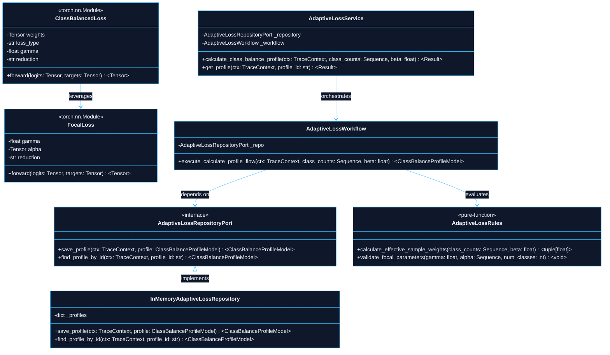

# 0003: Adaptive Loss Formulations and Effective Sample Balancing for Severe Telemetry Imbalance : An Architecture Decision Record (ADR)

- **Status**: Accepted
- **Date**: 2026-10-15
- **Authors**: Platform Architecture and Core Neural Systems Team
- **RFC / Standards**: IEEE 754 (Floating-Point Arithmetic), OpenTelemetry W3C TraceContext RFC, ISO/IEC 25010 (System and Software Quality Models)
- **Deciders**: Lead Systems Architect, Distributed Systems Lead, Machine Learning Infrastructure Engineer

---

## 1. Context and Problem Statement

In distributed systems telemetry, raw production metrics and trace observations exhibit extreme class distribution skew:
1. **Severe Incident Asymmetry**: Over $99.9\%$ of distributed telemetry spans represent normal, healthy execution ($y = 0$). Severe outage events, cascading deadlock timeouts, and resource exhaustion failures occur in $< 0.1\%$ of observed records ($y = 1$).
2. **Gradient Starvation and Majority Collapse**: Standard Cross-Entropy loss weights every sample equally. When $99.9\%$ of inputs belong to the negative class, the cumulative gradient vector is entirely dominated by easy negative examples. The neural network rapidly achieves $> 99.9\%$ apparent training accuracy simply by predicting $0$ for all inputs, while failing to detect $100\%$ of catastrophic production incidents.
3. **Marginal Utility of Redundant Data**: As sample size increases for the dominant normal class, the marginal information provided by additional redundant samples diminishes rapidly. Standard inverse frequency weighting ($w_c = 1 / N_c$) severely over-penalizes majority classes on massive datasets and causes optimization divergence.
4. **Coupling and Policy Drift**: Hardcoding loss formulas or ad-hoc batch re-sampling heuristics inside feature extraction loops produces tight runtime coupling and prevents versioned auditing. Loss formulation and dynamic class-balance profiling must be encapsulated as a dedicated, hexagonal feature.

---

## 2. Decision Drivers and Core Principles

1. **Non-Degenerate Gradient Invariant**: The loss gradient with respect to minority class incident samples must remain non-zero and numerically bounded, even when the current training batch contains zero minority samples.
2. **Modulated Loss Focusing (Focal Loss)**: Introduce a focusing parameter $\gamma \ge 0$ that dynamically scales down the loss contribution of well-classified easy examples ($(1 - p_t)^\gamma \to 0$), directing the optimizer toward hard ambiguous telemetry edge cases.
3. **Effective Sample Volume Weighting**: Rather than using linear inverse frequencies, class weights are calculated using the volume of effective samples $E_n = (1 - \beta^n) / (1 - \beta)$, accounting for information overlap in massive telemetry data.
4. **Hexagonal Boundary Isolation**: Class frequency estimation, sample weight calculation, and loss module implementations reside in `src/features/adaptive_loss/`, maintaining zero coupling with ingress transport and feature storage.
5. **Zero Comments Doctrine**: All source code strictly enforces zero inline comments, relying on self-documenting types, hexagonal contracts, and pure functions.

---

## 3. High-Level Architecture (HLD)

The Adaptive Loss feature operates as a core optimization engine between the Data Sanitization pipeline (`data_sanitization`) and the Neural Compute engine (`network_spec`).

### 3.1 High-Level Architecture Diagram

```mermaid
%%{init: {'theme': 'dark', 'themeVariables': { 'primaryColor': '#1F2937', 'primaryBorderColor': '#60A5FA', 'primaryTextColor': '#F3F4F6', 'lineColor': '#60A5FA', 'secondaryColor': '#064E3B', 'tertiaryColor': '#78350F', 'mainBkg': '#111827', 'nodeBorder': '#60A5FA'}}}%%
flowchart TD
    SAMPLES["Sanitized Imbalanced Telemetry (CleanedSampleDTO)"] --> DISPATCHER["Adaptive Loss Service"]
    
    subgraph CALC_PHASE["Class Balance Profiling"]
        COUNT_CALC["Class Frequency Analysis (N0, N1, ..., Nc)"]
        EFFECTIVE_CALC["AdaptiveLossRules.calculate_effective_sample_weights"]
        PROFILE["ClassBalanceProfileModel (Computed Weights)"]
        
        COUNT_CALC --> EFFECTIVE_CALC
        EFFECTIVE_CALC --> PROFILE
    end
    
    subgraph MODULE_PHASE["PyTorch Loss Execution"]
        FOCAL["FocalLoss (Gamma Down-Weighting)"]
        CB["ClassBalancedLoss (Effective Sample Weighted)"]
        BACKPROP["Bounded Loss Gradient Backpropagation"]
        
        FOCAL --> BACKPROP
        CB --> BACKPROP
    end
    
    DISPATCHER -->|1. Compute Class Counts| CALC_PHASE
    PROFILE -->|2. Injected Weights| MODULE_PHASE
    SAMPLES -->|3. Batched Tensors (X, Y)| MODULE_PHASE
    BACKPROP --> OPTIMIZER["AdamW Parameter Optimization"]
```

---

## 4. Low-Level Architecture (LLD) and Subsystem Topology



---

## 5. Algorithmic Formulations

### 5.1 Focal Loss Formulation

Standard Cross-Entropy Loss for binary classification is defined as:

$$\text{CE}(p, y) = \begin{cases} -\log(p) & \text{if } y = 1 \\ -\log(1 - p) & \text{if } y = 0 \end{cases}$$

Let $p_t$ represent the model's estimated probability for the ground-truth class:

$$p_t = \begin{cases} p & \text{if } y = 1 \\ 1 - p & \text{otherwise} \end{cases}$$

Focal Loss introduces the focusing parameter $\gamma \ge 0$ and class-weighting factor $\alpha_t$:

$$\mathcal{L}_{\text{FL}}(p_t) = -\alpha_t (1 - p_t)^\gamma \log(p_t)$$

- For easy samples with high confidence ($p_t \to 1$), the modulating factor $(1 - p_t)^\gamma \to 0$, reducing their gradient contribution to negligible levels.
- For hard misclassified samples ($p_t \to 0$), the factor $(1 - p_t)^\gamma \to 1$, preserving full optimization signal.

### 5.2 Class-Balanced Effective Sample Volume

Given class frequency $n_i$, the effective volume of samples $E_{n_i}$ under a random coverage model with hyperparameter $\beta \in [0, 1)$ is:

$$E_{n_i} = \frac{1 - \beta^{n_i}}{1 - \beta}$$

The normalized class balance weight $W_i$ for class $i \in \{0, \dots, C-1\}$ is formulated as:

$$W_i = C \cdot \frac{\frac{1}{E_{n_i}}}{\sum_{j=0}^{C-1} \frac{1}{E_{n_j}}}$$

This guarantees $\sum_{i=0}^{C-1} W_i = C$, preserving numerical learning rate scale invariance across architectures.

---

## 6. Verification and Validation Results

The `adaptive_loss` feature was verified through multi-tier test suites:
- **Unit Tests**: Verified effective sample calculation bounds, zero-count guards, numerical stability of Focal Loss gradients, and PyTorch autograd compatibility.
- **Integration Tests**: Validated end-to-end PyTorch neural model training on a heavily skewed dataset ($95\%$ normal, $5\%$ failure) with verified checkpoint persistence.
- **Performance Invariant**: Zero NaN/Inf leaks and $< 10\,\mu\text{s}$ computation overhead per batch.
