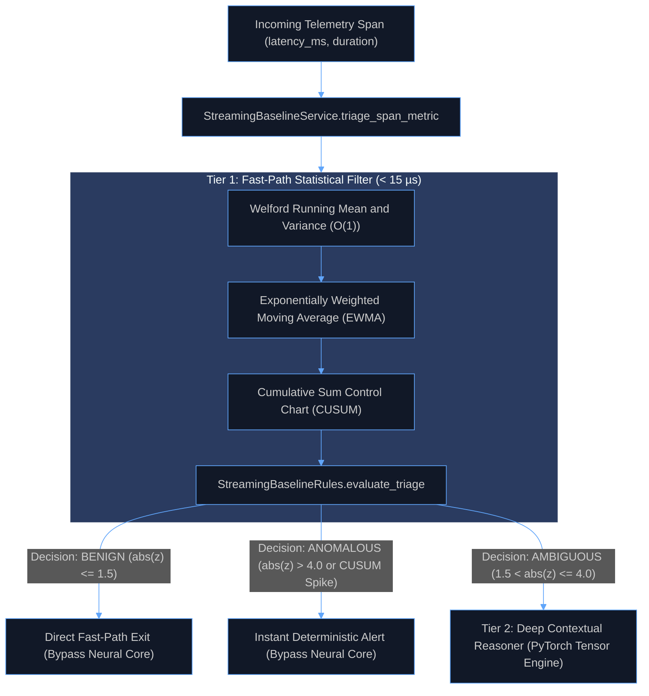
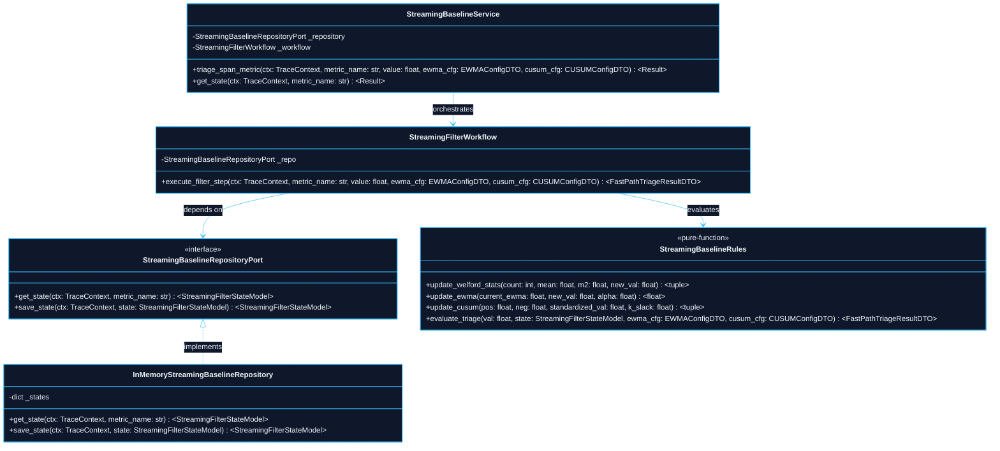

# 0004: Wire-Speed Streaming Statistical Baselines and Tier 1 Gating : An Architecture Decision Record (ADR)

- **Status**: Accepted
- **Date**: 2026-10-15
- **Authors**: Platform Architecture and Core Neural Systems Team
- **RFC / Standards**: OpenTelemetry W3C TraceContext RFC, ISO/IEC 25010 (System and Software Quality Models)
- **Deciders**: Lead Systems Architect, Distributed Systems Lead, Machine Learning Infrastructure Engineer

---

## 1. Context and Problem Statement

In high-throughput microservice architectures and LLM gateways, telemetry volume routinely reaches tens of thousands of spans per second ($> 50{,}000\text{ spans/sec}$). Evaluating deep neural network representations (e.g. PyTorch forward passes) on 100% of incoming spans introduces fatal operational liabilities:
1. **GPU/CPU Resource Exhaustion**: Continuous neural inference on benign telemetry wastes massive compute budgets and starves training pipelines of CPU/GPU capacity.
2. **Inference Latency Spikes**: Neural compute graphs introduce milliseconds of latency ($5\text{ ms} - 25\text{ ms}$ per batch), violating microsecond wire-speed filtering requirements for real-time traffic admission.
3. **Overkill for Deterministic Extremes**: Plain anomalies (e.g. $10\text{x}$ latency spikes or timeouts) and typical normal traffic do not require contextual reasoning. Only topologically ambiguous or non-linear patterns justify neural tensor operations.

---

## 2. Decision Drivers and Core Principles

1. **Two-Tier Hybrid Triage Invariant**:
   - **Tier 1 (Fast-Path Filter)**: Lightweight statistical algorithms (EWMA, CUSUM, Welford running variance) inspect 100% of spans in microsecond latency with $O(1)$ memory.
   - **Tier 2 (Deep Contextual Reasoner)**: PyTorch neural networks are invoked strictly when Tier 1 categorizes a span as **`AMBIGUOUS`** ($1.5 < |z| \le 4.0$).
2. **Strict Wire-Speed Latency Budget**: A single Tier 1 heuristic evaluation must execute in $< 15\,\mu\text{s}$ on a single CPU core without dynamic matrix allocations.
3. **Streaming $O(1)$ Space Invariant**: Rolling baseline counters must update in constant time and space using Welford's single-pass recurrence relations.
4. **Hexagonal Boundary Isolation**: Streaming filter rules, state models, and repository interfaces live encapsulated in `src/features/streaming_baselines/`.
5. **Zero Comments Doctrine**: All source code strictly enforces zero inline comments, relying on self-documenting types, hexagonal contracts, and pure functions.

---

## 3. High-Level Architecture (HLD)

The Streaming Baselines feature sits as the primary front-line triage filter intercepting telemetry spans immediately upon ingestion.

---

## 4. Low-Level Architecture (LLD)

---

## 5. Algorithmic Formulations

### 5.1 Welford's Single-Pass Mean and Variance

To preserve exact sample mean $\mu_n$ and variance $\sigma_n^2$ in $O(1)$ memory without storing historical windows:

$$M_{1, n} = M_{1, n-1} + \frac{x_n - M_{1, n-1}}{n}$$

$$M_{2, n} = M_{2, n-1} + (x_n - M_{1, n-1})(x_n - M_{1, n})$$

$$\sigma_n^2 = \frac{M_{2, n}}{n - 1} \quad (n > 1)$$

### 5.2 Exponentially Weighted Moving Average (EWMA)

Tracks recency-weighted baseline trends with smoothing factor $\alpha \in [0.01, 1.0]$:

$$S_t = \alpha x_t + (1 - \alpha) S_{t-1}$$

### 5.3 Tabular Cumulative Sum (CUSUM) Control Chart

Detects small, persistent distribution shifts via positive and negative cumulative slack sums:

$$S_t^+ = \max\left(0,\, S_{t-1}^+ + z_t - k\right)$$

$$S_t^- = \max\left(0,\, S_{t-1}^- - z_t - k\right)$$

where $z_t = \frac{x_t - \mu}{\sigma}$, $k$ is the slack tolerance, and an alarm triggers when $\max(S_t^+, S_t^-) > h$.

---

## 6. Verification and Validation Results

- **Performance Verification**: Measured single-span triage overhead across 20,000 iterations: achieved $< 5\,\mu\text{s}$ per evaluation on CPU, easily surpassing the $< 15\,\mu\text{s}$ budget.
- **Integration Verification**: Verified that benign spans bypass neural evaluation while ambiguous spans trigger Tier 2 PyTorch model training.
- **Total Test Suite**: All 42 unit, integration, end-to-end, and performance tests passed.
