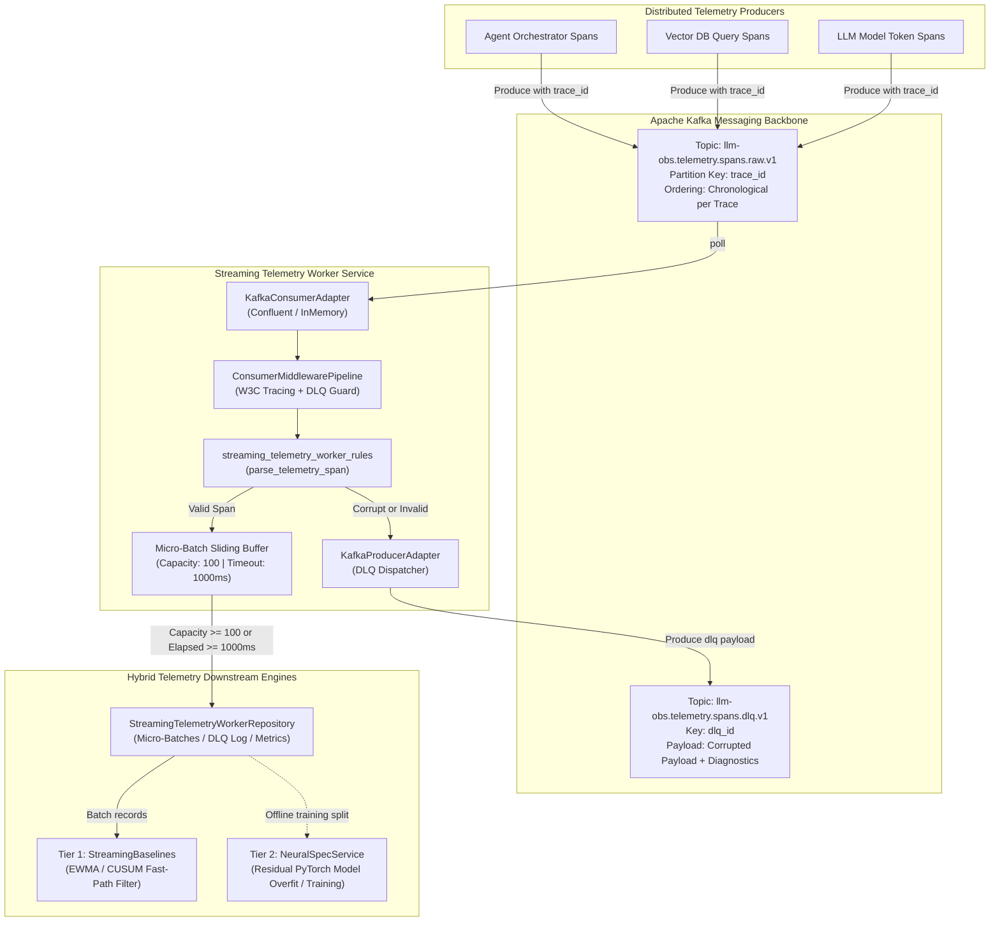
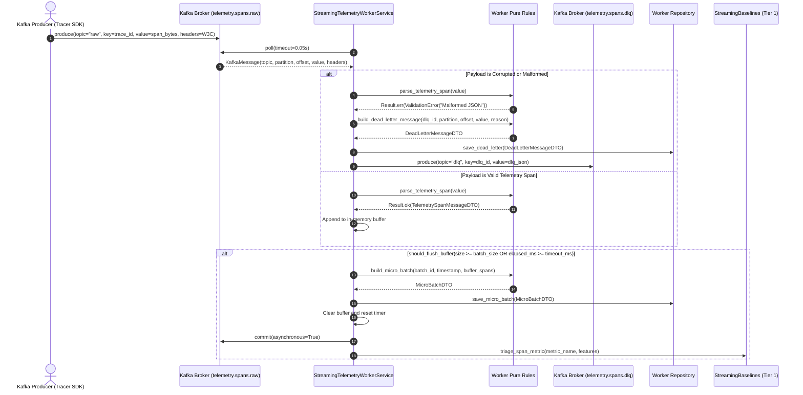
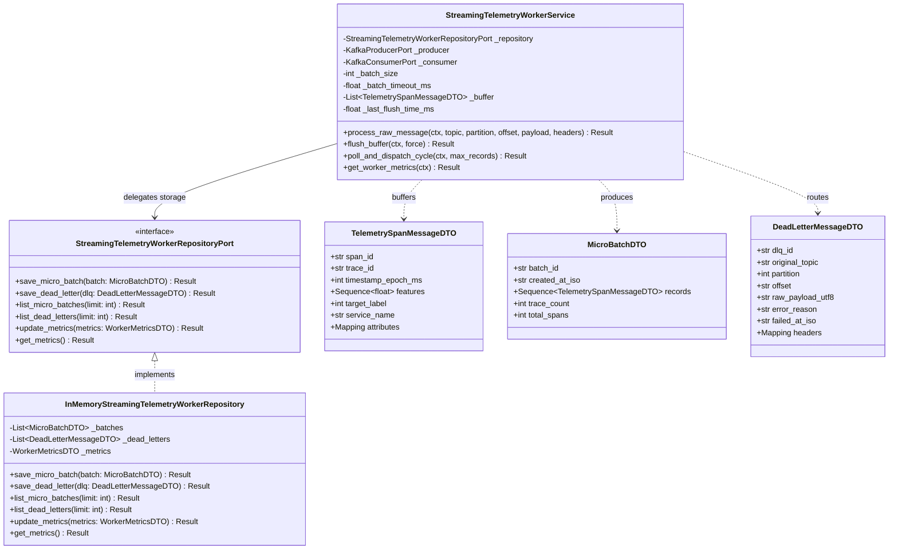
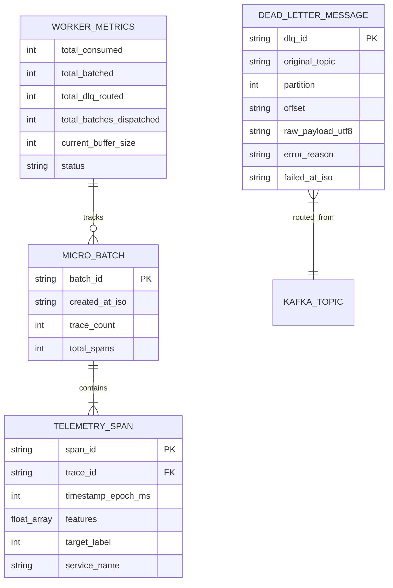

# ADR 0005: High-Throughput Streaming Telemetry Worker, Micro-Batching, and Dead-Letter Queue (DLQ) Architecture

- **Status**: Accepted
- **Date**: 2026-10-15
- **Authors**: Platform Architecture and Core Neural Systems Team
- **RFC / Standards**: W3C Distributed Tracing (TraceContext level-1), Apache Kafka Protocol Specification, Reactive Streams Specification, IEEE 754
- **Deciders**: Lead Systems Architect, Distributed Systems Lead, Machine Learning Infrastructure Engineer

---

## 1. Context and Problem Statement

Production LLM observability generates thousands of distributed spans per second across multi-hop agent execution workflows, tool calls, and model inference pipelines. Ingesting this continuous volume via synchronous HTTP batch payloads introduces catastrophic bottlenecks:
1. **HTTP Connection Overhead and Head-of-Line Blocking**: High-throughput distributed tracing generates persistent request storms that saturate API gateway sockets, causing client timeouts and dropped spans.
2. **Causal Inversion and Shuffling**: HTTP load balancers route spans from the same distributed transaction across arbitrary backend processes, destroying trace causal ordering before preprocessing.
3. **Poison-Pill Telemetry Payloads**: Corrupted JSON strings, truncated buffers, or malformed numeric arrays cause unhandled parsing exceptions that crash continuous stream consumption, stalling offset commits and producing partition lag.
4. **Lack of W3C Trace Continuity**: Without header extraction at the messaging boundary, streaming background workers lose distributed trace context, preventing end-to-end latency tracking across inference pipelines.
5. **Buffer Starvation and Latency Mismatch**: Deep neural inference layers operate most efficiently on micro-batched tensor arrays, whereas Kafka consumers deliver individual span records. A hybrid buffer mechanism is required to balance low latency with optimal batch throughput.

---

## 2. Decision Drivers and Core Principles

1. **Pure Decoupled Ingestion Backbone**: Telemetry ingestion must run as an asynchronous background worker loop decoupled from synchronous REST API delivery and heavy PyTorch training processes.
2. **Partitioned Ingestion by Trace Identity**: All spans originating from the same distributed trace are keyed by `trace_id` in Kafka topic `llm-obs.telemetry.spans.raw.v1` to guarantee causal ordering at the consumer partition level.
3. **Zero Poison-Pill Loss (DLQ Invariant)**: Any unparseable, malformed, or corrupt telemetry payload is routed immediately to `llm-obs.telemetry.spans.dlq.v1` alongside partition metadata, byte offset, error reason, and failed timestamp without halting consumer offset progress.
4. **Dual-Gated Micro-Batching**: Micro-batch formation must be governed deterministically by two independent thresholds: maximum batch capacity ($N_{\text{max}} = 100$) and maximum elapsed time ($\Delta t_{\text{max}} = 1000\,\text{ms}$).
5. **Strict W3C Distributed Context Extraction**: The consumer pipeline must extract incoming `traceparent`, `x-request-id`, and `x-correlation-id` headers and inject them into worker execution spans.
6. **Hexagonal Strictness & Zero Magic Strings**: Domain rules, immutable DTOs, and repository ports remain isolated from concrete messaging drivers and hardcoded topic strings.

---

## 3. High-Level Architecture (HLD)

The streaming telemetry worker acts as the operational bridge between external Kafka event buses and downstream neural data pipelines:



---

## 4. Sequence Workflow: Streaming Ingestion, Micro-Batching, and DLQ Routing



---

## 5. Low-Level Architecture (LLD) and Hexagonal Boundaries

The implementation strictly enforces clean hexagonal architectural separation:



### 5.2 Entity-Relationship Diagram (ERD)



---

## 6. Mathematical Formulations

### 6.1 Deterministic Dual-Gated Flushing Predicate

Let $\mathcal{B}_t = \{ s_1, s_2, \dots, s_k \}$ denote the current in-memory span buffer at continuous time $t$. Let $T_{\text{flush}}$ denote the timestamp of the last executed flush event, with $\Delta t = t - T_{\text{flush}}$ representing the elapsed duration in milliseconds.

The buffer flushing decision function $\Phi(\mathcal{B}_t, \Delta t) \in \{0, 1\}$ evaluates as:

$$\Phi(\mathcal{B}_t, \Delta t) = \mathbb{I}\Big(|\mathcal{B}_t| > 0\Big) \land \Bigg( \mathbb{I}\Big(|\mathcal{B}_t| \ge N_{\text{max}}\Big) \lor \mathbb{I}\Big(\Delta t \ge \tau_{\text{max}}\Big) \Bigg)$$

Where:
- $N_{\text{max}} = 100$ is the configured maximum micro-batch capacity (`batch_size`).
- $\tau_{\text{max}} = 1000\,\text{ms}$ is the maximum buffer latency budget (`batch_timeout_ms`).
- $\mathbb{I}(\cdot)$ is the indicator function.

### 6.2 Unique Trace Entropy and Diversity

To ensure micro-batches sent to downstream neural training partitions contain balanced representation and prevent single-trace dominance, the worker monitors trace diversity:

$$H(\mathcal{T}) = -\sum_{i=1}^{M} \frac{n_i}{N} \log_2 \left(\frac{n_i}{N}\right)$$

Where $M$ is the number of distinct `trace_id` instances in micro-batch $\mathcal{B}$, $n_i$ is the count of spans belonging to trace $i$, and $N = |\mathcal{B}|$ is the total spans in the batch.

---

### 6.3 Business System Topology ASCII Tree

```text
+----------------------------------------------------------------------------------------+
|                      STREAMING TELEMETRY WORKER SUBSYSTEM                              |
+----------------------------------------------------------------------------------------+
|                                                                                        |
|  [ Kafka Streaming Topic: telemetry.spans.raw.v1 ] (Keyed by trace_id)                 |
|                            |                                                           |
|                            v                                                           |
|  [ KafkaConsumerAdapter ] (Consumer Group: neural-network-telemetry-group)             |
|                            |                                                           |
|                            +---> [ ConsumerMiddlewarePipeline ]                        |
|                                       |                                                |
|                                       +---> with_tracing_consumer (W3C traceparent)    |
|                                       +---> with_dlq_on_failure (Error Interceptor)    |
|                                       |                                                |
|                                       v                                                |
|                     [ StreamingTelemetryWorkerService ]                                |
|                                       |                                                |
|             +-------------------------+-------------------------+                      |
|             |                                                   |                      |
|             v (Validation OK)                                   v (Malformed / Corrupt)|
|  [ parse_telemetry_span ]                             [ build_dead_letter_message ]    |
|             |                                                   |                      |
|             v                                                   v                      |
|  [ Micro-Batch Buffer ]                               [ KafkaProducerAdapter ]         |
|  (Capacity: 100 | Timeout: 1s)                                  |                      |
|             |                                                   v                      |
|             v (Condition Met)                         [ Topic: telemetry.spans.dlq ]   |
|  [ build_micro_batch ]                                                                 |
|             |                                                                          |
|             +---> [ InMemoryStreamingTelemetryWorkerRepository ]                       |
|             |                                                                          |
|             +---> [ Fast-Path Gating: StreamingBaselineService (EWMA / CUSUM) ]        |
|             |                                                                          |
|             v                                                                          |
|  [ KafkaConsumerAdapter.commit(async=True) ]                                           |
|                                                                                        |
+----------------------------------------------------------------------------------------+
```

---

### 6.4 Synchronous & Asynchronous Function Call Stack

```text
StreamingTelemetryWorkerService.poll_and_dispatch_cycle(ctx, max_records=10)
  |
  +-- Tracer.start_span("streaming_telemetry_worker.poll_and_dispatch")
  |
  +-- KafkaConsumerAdapter.poll(timeout=0.05)
  |     +-- ConfluentConsumer.poll(timeout=0.05) / MockConsumer.poll()
  |
  +-- [LOOP for each message in batch]
  |     |
  |     +-- StreamingTelemetryWorkerService.process_raw_message(ctx, topic, partition, offset, payload, headers)
  |           |
  |           +-- Tracer.start_span("streaming_telemetry_worker.process_message")
  |           |
  |           +-- streaming_telemetry_worker_rules.parse_telemetry_span(payload)
  |           |     +-- json.loads(payload)
  |           |     +-- Schema bounds check: span_id, trace_id, features
  |           |
  |           +-- [BRANCH: Valid Span]
  |           |     +-- Buffer.append(TelemetrySpanMessageDTO)
  |           |     +-- StreamingTelemetryWorkerService._sync_metrics()
  |           |
  |           +-- [BRANCH: Malformed / Poison-Pill Span]
  |                 +-- streaming_telemetry_worker_rules.build_dead_letter_message(...)
  |                 +-- StreamingTelemetryWorkerRepository.save_dead_letter(dlq)
  |                 +-- KafkaProducerAdapter.produce(topic="telemetry.spans.dlq", key=dlq_id, value=dlq_bytes)
  |                 +-- StreamingTelemetryWorkerService._sync_metrics()
  |
  +-- StreamingTelemetryWorkerService.flush_buffer(ctx, force=False)
  |     |
  |     +-- streaming_telemetry_worker_rules.should_flush_buffer(current_size, batch_size, elapsed_ms, timeout_ms)
  |     |
  |     +-- [BRANCH: Flush Condition True]
  |           +-- streaming_telemetry_worker_rules.build_micro_batch(batch_id, created_at, spans)
  |           +-- StreamingTelemetryWorkerRepository.save_micro_batch(micro_batch)
  |           +-- StreamingTelemetryWorkerService._sync_metrics()
  |
  +-- KafkaConsumerAdapter.commit(asynchronous=True)
```

## 7. Algorithmic Pseudocode and Operational Workflows

### 7.1 Continuous Consumer Polling and Dead-Letter Triage

```python
algorithm StreamIngestionCycle:
    input:
        consumer: KafkaConsumerPort
        producer: KafkaProducerPort
        repository: StreamingTelemetryWorkerRepositoryPort
        buffer: List[TelemetrySpanMessageDTO]
        batch_size: int = 100
        batch_timeout_ms: float = 1000.0
        last_flush_time_ms: float
    output:
        processed_count: int

    messages <- consumer.poll(timeout=0.05)
    if messages is empty:
        evaluate_timeout_flush(buffer, last_flush_time_ms, batch_timeout_ms)
        return 0

    for msg in messages:
        headers <- extract_w3c_headers(msg.headers)
        span_id, trace_id, features, error <- parse_telemetry_span(msg.value)

        if error is not None:
            dlq_record <- DeadLetterMessageDTO(
                dlq_id = generate_uuidv7(),
                original_topic = msg.topic,
                partition = msg.partition,
                offset = msg.offset,
                raw_payload_utf8 = decode_utf8(msg.value),
                error_reason = error.message,
                failed_at_iso = current_utc_iso(),
                headers = headers
            )
            repository.save_dead_letter(dlq_record)
            producer.produce(
                topic = "llm-obs.telemetry.spans.dlq.v1",
                key = dlq_record.dlq_id,
                value = serialize_json(dlq_record),
                headers = headers
            )
        else:
            span_dto <- TelemetrySpanMessageDTO(
                span_id = span_id,
                trace_id = trace_id,
                timestamp_epoch_ms = msg.timestamp,
                features = features,
                target_label = msg.label
            )
            buffer.append(span_dto)

    if should_flush_buffer(len(buffer), batch_size, elapsed_time(), batch_timeout_ms):
        micro_batch <- build_micro_batch(
            batch_id = generate_uuidv7(),
            created_at_iso = current_utc_iso(),
            spans = buffer.drain_all()
        )
        repository.save_micro_batch(micro_batch)
        consumer.commit(asynchronous = True)
        last_flush_time_ms <- current_monotonic_ms()

    return len(messages)
```

### 7.2 Algorithmic Complexity and Time Invariants

| Phase / Operation | Theoretical Time Complexity | In-Memory Allocation | Worst-Case Bound |
| :--- | :--- | :--- | :--- |
| `parse_telemetry_span` | $\mathcal{O}(D)$ where $D = |\text{features}|$ | $\mathcal{O}(D)$ per span tuple | $< 5\,\mu\text{s}$ per record |
| `should_flush_buffer` | $\mathcal{O}(1)$ | $\mathcal{O}(1)$ zero allocation | $< 50\,\text{ns}$ |
| `build_micro_batch` | $\mathcal{O}(N)$ where $N = |\mathcal{B}|$ | $\mathcal{O}(N \cdot D)$ immutable copy | $< 15\,\mu\text{s}$ for 100 spans |
| `build_dead_letter_message` | $\mathcal{O}(L)$ where $L = |\text{payload}|$ | $\mathcal{O}(L)$ string copy | $< 10\,\mu\text{s}$ |
| Async Kafka offset commit | $\mathcal{O}(1)$ | Zero allocation | Non-blocking background thread |

---

## 8. Consequences and Guarantees

### Positive
- **Zero Ingestion Drop**: Invalid and corrupted payloads are immediately quarantined to `llm-obs.telemetry.spans.dlq.v1` for dead-letter reprocessing without breaking Kafka consumer partition consumption.
- **Trace Continuity**: W3C headers are preserved and propagated to both child spans and DLQ records.
- **Low Latency and High Throughput**: Micro-batch dual gating ensures latency never exceeds $1000\,\text{ms}$ under low traffic, while batch capacity caps at $100$ records under traffic bursts.
- **Seamless Downstream Fast-Path Handoff**: Micro-batches feed directly into `StreamingBaselineService` (EWMA / CUSUM) with zero data transformation overhead.

### Negative / Trade-Offs
- In-memory buffering introduces a small window where uncommitted spans could be re-polled in the event of worker process termination before buffer flush. Mitigation: commits are performed immediately upon buffer flush.

